# ⚡ Zsyio — Enterprise WorkOS

Zsyio is a unified, multi-application workspace for project execution, collaborative documentation, human resource management, centralized identity administration, and sales pipeline conversion.

### 📦 Applications in the Suite
* **Zsyio Flow (`apps/pms`)**: Product workflows, tasks, sprint boards, and client deliverables.
* **Zsyio Canvas (`apps/notes`)**: Notion-like collaborative docs, team notes, and knowledge hub.
* **Zsyio People (`apps/hrms`)**: Attendance punch station, work sessions, breaks, and timesheets.
* **Zsyio Console (`apps/admin`)**: User directory, roles & permissions matrix, teams, and security policies.
* **Zsyio Pulse (`apps/sales`)**: Sales pipeline, CRM leads, 7-stage Kanban board, and client deal flow.
* **Zsyio Recruit (`apps/recruit`)**: Job openings, candidate pipeline, interviews, and hiring feedback.

---

## 📸 Screenshots

All apps share one sign-in and one design system. Screenshots are taken with the seeded demo data.

### Sign in

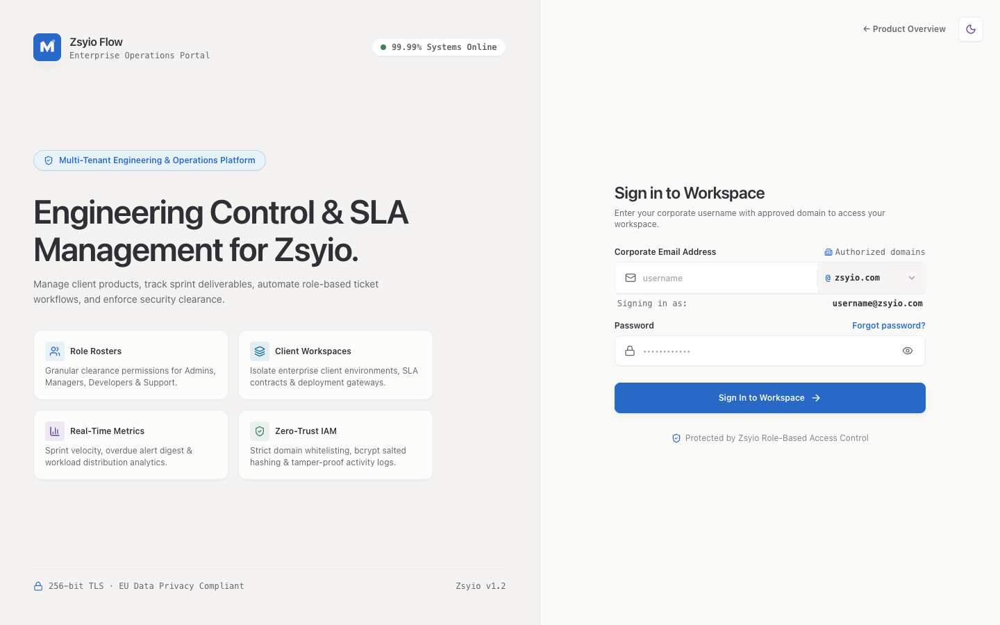

### Zsyio Flow — project management

| Dashboard | Task board |
| --- | --- |
| 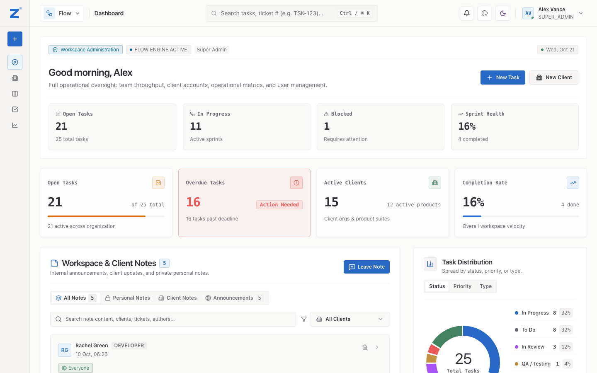 | 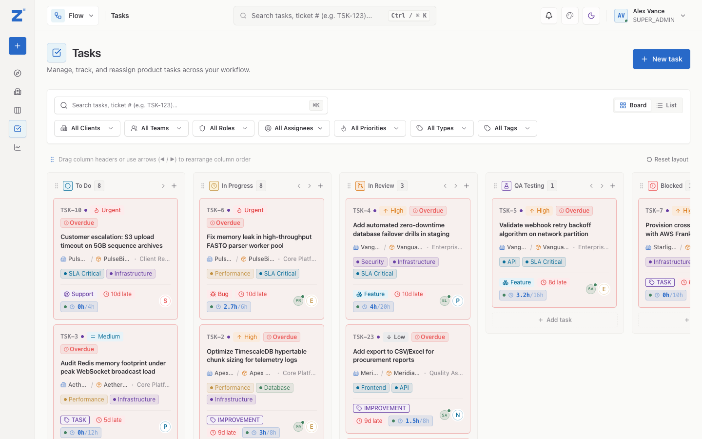 |
| **Client pipeline** | **Reports** |
| 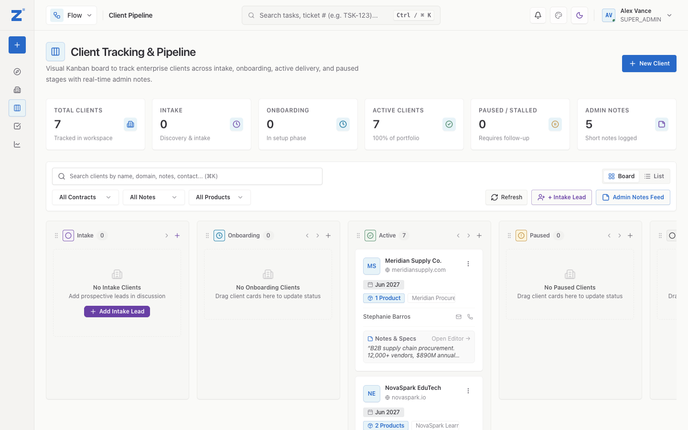 | 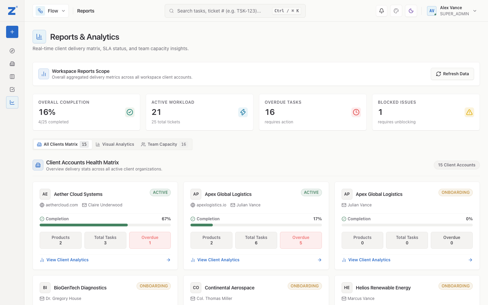 |

### Zsyio Canvas — notes and docs

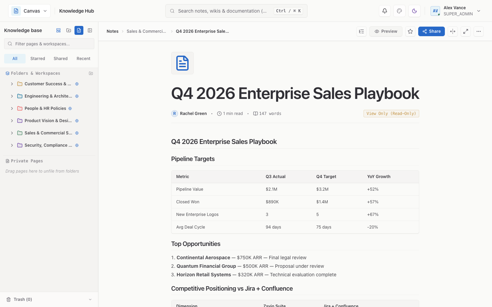

### Zsyio People — HR and attendance

| Dashboard | Team directory |
| --- | --- |
| 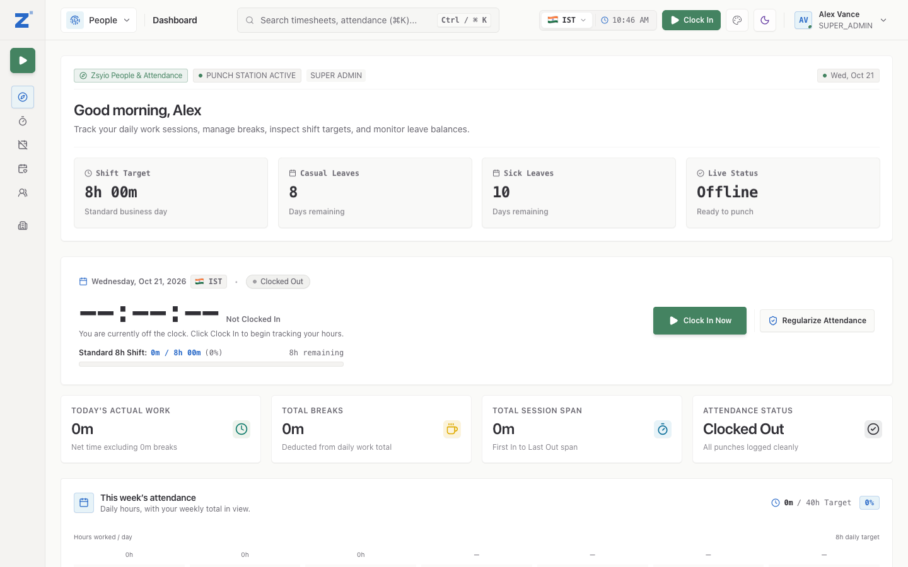 | 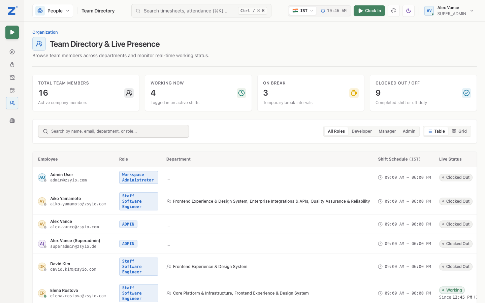 |
| **Team attendance** | |
| 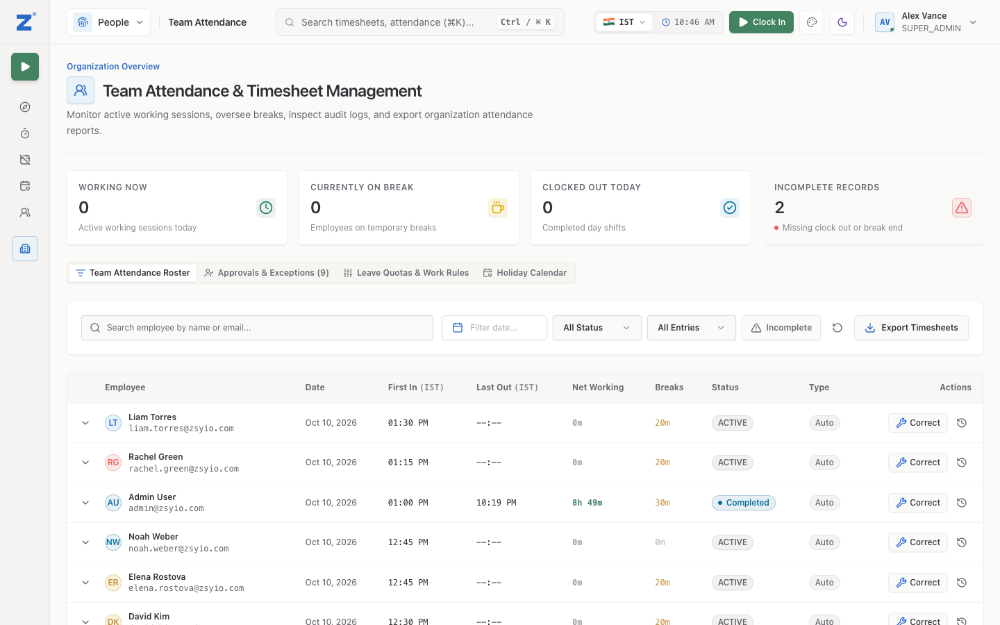 | |

### Zsyio Console — admin

| Dashboard | Users |
| --- | --- |
| 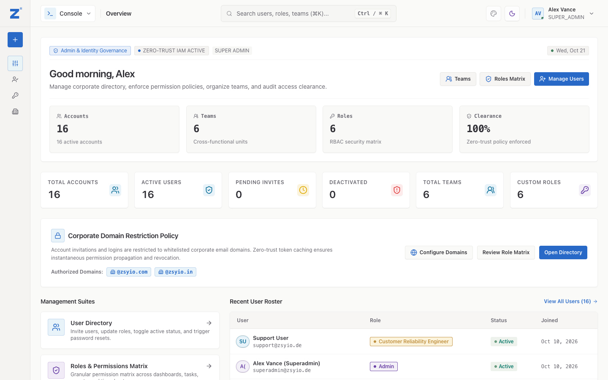 | 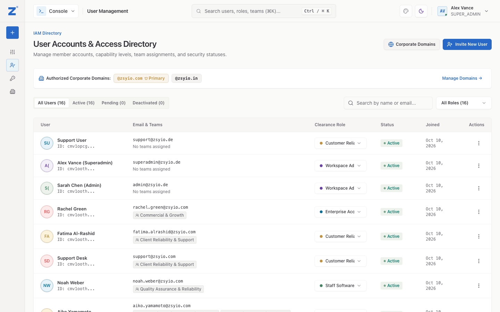 |
| **Roles and permissions** | |
| 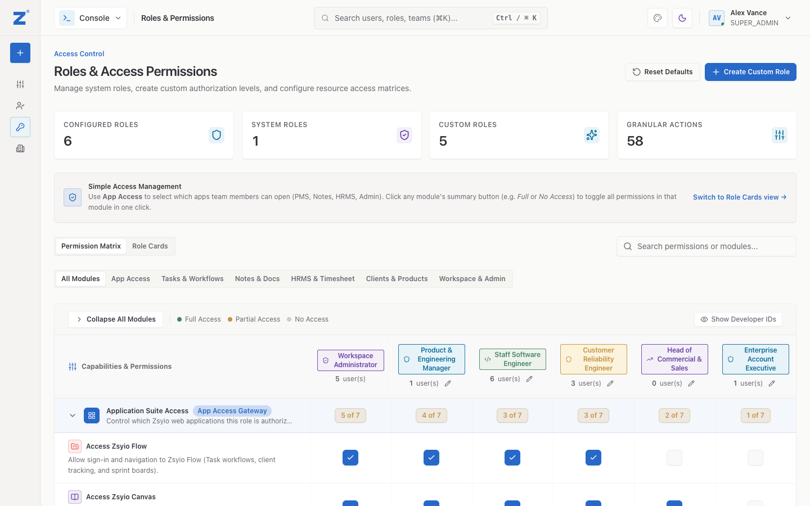 | |

### Zsyio Pulse — sales CRM

| Dashboard | Deal pipeline |
| --- | --- |
| 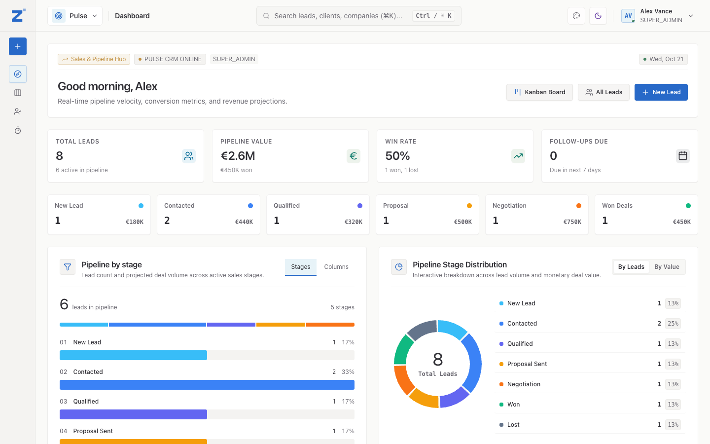 | 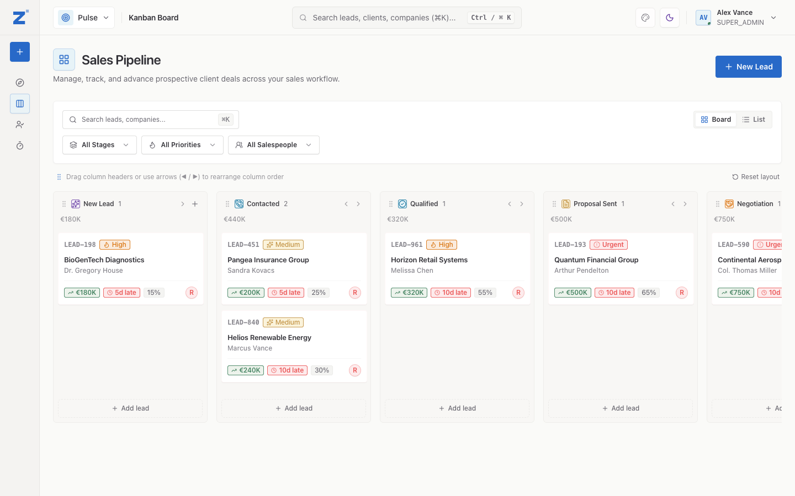 |

### Zsyio Recruit — hiring

| Jobs | Candidate pipeline |
| --- | --- |
| 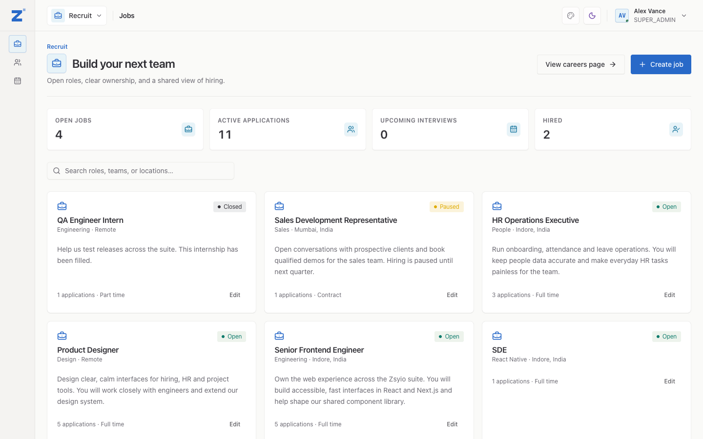 | 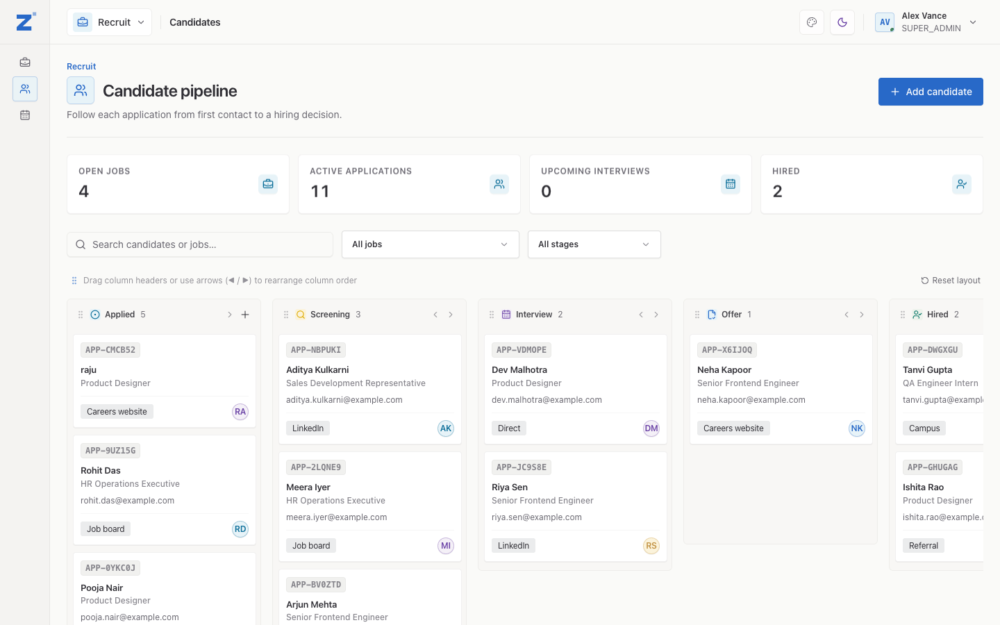 |

---

## 🚀 Key Features

* **Client & Product Tracking**: Manage client accounts, domains, contracts, and deployed product instances across multiple environments.
* **Task & Ticket Workflows**: Kanban board, list view, hierarchical sorting, custom statuses/columns, and dynamic custom task types.
* **Granular Role-Based Access Control**: Strict server-side permission engine (`SUPER_ADMIN`, `ADMIN`, `MANAGER`, `DEVELOPER`, `SUPPORT`, plus custom workspace roles).
* **QA Test Sheets**: Task-level test cases with status verification, notes, and tester tracking.
* **Integrated Notes & Knowledge Hub**: Client notes, dashboard broadcasts, and markdown document sharing across users, teams, and roles.
* **Design Token System**: Single-source brand styling compiled directly to CSS variables and Tailwind v4.

---

## 🛠️ Tech Stack

* **Framework**: [Next.js 15](https://nextjs.org/) (App Router, React 19)
* **Language**: [TypeScript](https://www.typescriptlang.org/) (Strict Mode)
* **Database & ORM**: PostgreSQL via [Prisma](https://www.prisma.io/)
* **Authentication**: [NextAuth.js](https://next-auth.js.org/) (JWT session strategy)
* **State Management**: [Redux Toolkit](https://redux-toolkit.js.org/) & [RTK Query](https://redux-toolkit.js.org/rtk-query/overview)
* **Styling**: [Tailwind CSS v4](https://tailwindcss.com/) with [shadcn/ui](https://ui.shadcn.com/) primitives
* **Validation**: [Zod](https://zod.dev/)

---

## 📖 Documentation

* **[Microfrontend deployment](docs/microfrontends.md)** — Six independent app deployments, subdomain routing, shared sign-in, and production preflight checks.

All detailed project documentation is organized in the [`docs/`](docs) directory:

* 📘 **[Official Rule Book (`docs/rulebook.md`)](docs/rulebook.md)** — Architectural principles, permission rules, workflow state machines, and code standards.
* 🚀 **[Deployment Guide (`docs/deployment.md`)](docs/deployment.md)** — Production setup, Supabase database configuration, Vercel hosting, and Cron digest setup.
* 🏗️ **[Technical Build Spec (`docs/architecture/build-spec-v2.md`)](docs/architecture/build-spec-v2.md)** — Reconciled architecture, entity relations, and data schemas.
* 🧭 **[Documentation Hub (`docs/README.md`)](docs/README.md)** — Complete index of all available documentation.

---

## 📂 Project Structure

```
├── .github/              # CI/CD workflows and security automation
├── docs/                 # Architectural specifications, rulebook, and guides
├── plugins/              # Swappable branding & theme plugins
│   └── branding/         # Brand definitions (logos, icons, color palettes)
├── prisma/               # Database schemas (modular), migrations, and seeds
│   ├── schema/           # Split domain schemas (task, user, client, notes, etc.)
│   └── migrations/       # Versioned SQL schema migrations
├── public/               # Static web assets (branding SVGs, service worker)
├── scripts/              # Build tools, token compiler, database cleaning utilities
├── src/                  # Main application source code
│   ├── app/              # Next.js 15 App Router (pages, layouts, API routes)
│   │   ├── (auth)/       # Authentication pages (login, invite, reset password)
│   │   ├── (dashboard)/  # Main workspace pages (clients, tasks, notes, reports)
│   │   └── api/          # REST API endpoints grouped by domain entity
│   ├── components/       # Feature-driven React components
│   │   ├── clients/      # Client management, profile, and intake Kanban
│   │   ├── dashboard/    # Overview cards, metric widgets, and feeds
│   │   ├── notes/        # Markdown documentation editor and folder tree
│   │   ├── products/     # Product catalog and environment management
│   │   ├── reports/      # Workload analytics and capacity visualizations
│   │   ├── roles/        # Granular RBAC permissions matrix
│   │   ├── shared/       # Reusable UI widgets (modals, dialogs, editors)
│   │   ├── tasks/        # Task boards, modals, test sheets, Git helpers
│   │   ├── ui/           # Atomic Radix UI / design primitive components
│   │   └── users/        # User tables, role badges, invitation modals
│   ├── lib/              # Core utilities, AI integrations, providers, validators
│   │   ├── ai/           # Google Gemini helpers (branch slugs, summaries, test cases)
│   │   ├── providers/    # Email (ZeptoMail/Resend) & Storage providers
│   │   └── validators/   # Zod validation schemas & TypeScript input types
│   ├── server/           # Backend business logic layer
│   │   ├── repositories/ # Database query layer (Prisma queries)
│   │   └── services/     # Business logic, permissions, and side-effects
│   ├── store/            # Redux Toolkit state & RTK Query API client
│   ├── styles/           # Design system tokens and global CSS
│   └── types/            # TypeScript domain models and NextAuth definitions
├── tests/                # Vitest automated unit and integration tests
└── tokens/               # Design token definitions (primitives.json)
```

---

## 🔐 Environment Configuration

Environment variables are managed locally via `.env.local` (which is gitignored to protect sensitive secrets):

| File | Purpose | Version Controlled? |
| :--- | :--- | :--- |
| **`.env.example`** | Clean template documenting all required variables with placeholder values | ✅ Yes |
| **`.env.local`** | Your local developer environment secrets and database connections | ❌ No (Gitignored) |

---

## ⚡ Getting Started

### 1. Clone & Install Dependencies
```bash
git clone <repo-url>
cd PMS-Mediloom
npm install
```

### 2. Configure Environment Variables
Copy `.env.example` to `.env.local` and set your credentials:
```bash
cp .env.example .env.local
```

### 3. Setup Database & Migrations
```bash
npx prisma migrate dev
```

### 4. Build Tokens & Start Development Server
```bash
npm run build:tokens
npm run dev
```

Visit `http://localhost:3000` in your browser.

---

## 🧪 Build & Test Verification

```bash
# Type check without emitting files
npx tsc --noEmit

# Production build
npm run build

# Run unit & integration tests
npm run test
```
