# Zsyio Flow — Enterprise Project, Sprint & Task Management (PMS)

> **The High-Velocity Engineering & Delivery Engine of the Zsyio Operating System**

---

## 1. What is Zsyio Flow?

**Zsyio Flow** is the core execution and project delivery workspace of the Zsyio Suite. Engineered specifically for modern software engineering teams, product managers, and QA specialists, it transforms product roadmaps and client requirements into structured, trackable, and measurable engineering deliverables.

Unlike basic task boards, Zsyio Flow unifies the full development lifecycle in one pane of glass:
- Multi-dimensional sprint backlogs (interactive Kanban boards and high-density filterable tabular views).
- Active stopwatch and manual timesheet tracking directly tied to tickets for transparent client billing.
- Enterprise client management pipelines and delivery SLA tracking.
- Contextual AI features that summarize complex tasks, generate deterministic Git branch names (`feature/TSK-xxx`), and draft acceptance test cases.

---

## 2. Why Are We Using It? (The Problem It Solves)

Engineering organizations often struggle with **tool fragmentation, cognitive overhead, and lost context**:
- **Disjointed task tracking and time logging**: Developers build in Jira or Linear, but log hours in Harvest or Toggl, leading to inaccurate timesheets, missed billable hours, and delayed payroll reconciliation.
- **Siloed client delivery visibility**: Account managers communicate with clients via email, while developers work in an isolated issue tracker. Clients lack visibility into real delivery SLAs and milestone progress.
- **Context-switching penalty**: Engineers waste hours manually generating branch names, writing boilerplate ticket summaries, and deciphering ambiguous requirements without standardized templates.
- **Overpriced enterprise licenses**: Paying $15–$30/user/month for Jira or Linear plus additional fees for time tracking and reporting plugins.

### What Zsyio Flow Replaces:
- **Jira Software / Linear / Asana** for issue tracking, sprint backlogs, and Kanban boards.
- **Harvest / Toggl / Clockify** for developer time logging and stopwatch tracking.
- **Client portal add-ons** for enterprise account delivery tracking.

---

## 3. Who Is This App For? (Target Personas)

| Persona | Role in Organization | How They Use Zsyio Flow |
| :--- | :--- | :--- |
| **Engineering Leads & Architects** | Tech Leads, Staff Engineers | Breaks down architectural RFCs into actionable task hierarchies, monitors sprint burndown, and reviews PR branch links. |
| **Software Engineers** | Fullstack, Frontend, Backend | Manages daily active tasks, runs stopwatches while coding, uses the Git branch helper, and updates ticket status. |
| **Product Managers** | PMs, Technical Program Managers | Triages the backlog, prioritizes milestones, configures client-product mappings, and tracks delivery velocity. |
| **QA & Reliability Engineers** | Test Automation, Manual QA | Reviews acceptance criteria, links test cases to tickets, and verifies bug reproduction steps. |
| **Account Managers & Executives** | Client Delivery Leads | Monitors client delivery pipelines, tracks account SLAs, and reviews overall workspace completion health. |

---

## 4. How Zsyio Flow Connects With Other Apps

Zsyio Flow is deeply interconnected with the other 4 applications in the Zsyio ecosystem:

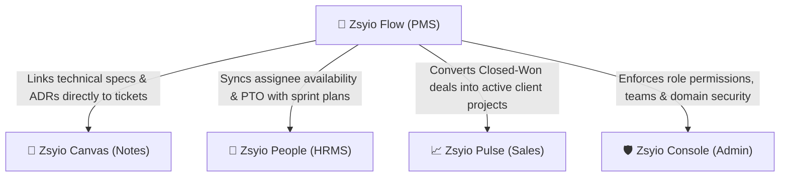

1. **Zsyio Canvas (Knowledge Base & RFCs)**:
   - When an engineer works on a complex architectural task, the ticket description embeds or links directly to the corresponding RFC, playbook, or ADR drafted in Canvas.
2. **Zsyio People (HRMS & Attendance)**:
   - Sprint assignments check developer availability. If an engineer is on approved leave or clocked out in People, Flow alerts the lead during sprint planning to prevent task bottlenecks.
3. **Zsyio Pulse (Sales CRM)**:
   - Once an enterprise contract is marked as `Closed Won` in Pulse, a new client account and delivery workspace are instantly provisioned in Flow.
4. **Zsyio Console (Central Admin & IAM)**:
   - User assignees, teams, and administrative privileges are strictly governed by Console's 56-action RBAC matrix.

---

## 5. Visual Walkthrough & Interface Guide

### 1. Executive Operations Dashboard
The mission control center displaying open task throughput, active sprint states, urgent blockers, and high-level health indicators.

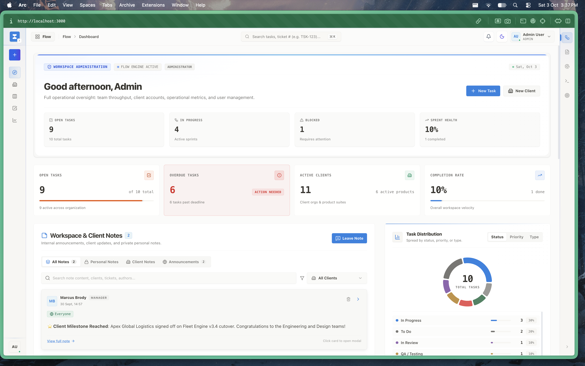

- **KPI Metrics**: Instant visibility into Open Tasks, In Progress workload, Blocked issues, and Overdue items.
- **Action Triggers**: Quick triggers to create tasks, register client accounts, or jump straight into team sprint boards.

---

### 2. Interactive Kanban Board
A multi-column visual board allowing engineering leads and product managers to transition tasks smoothly across statuses.

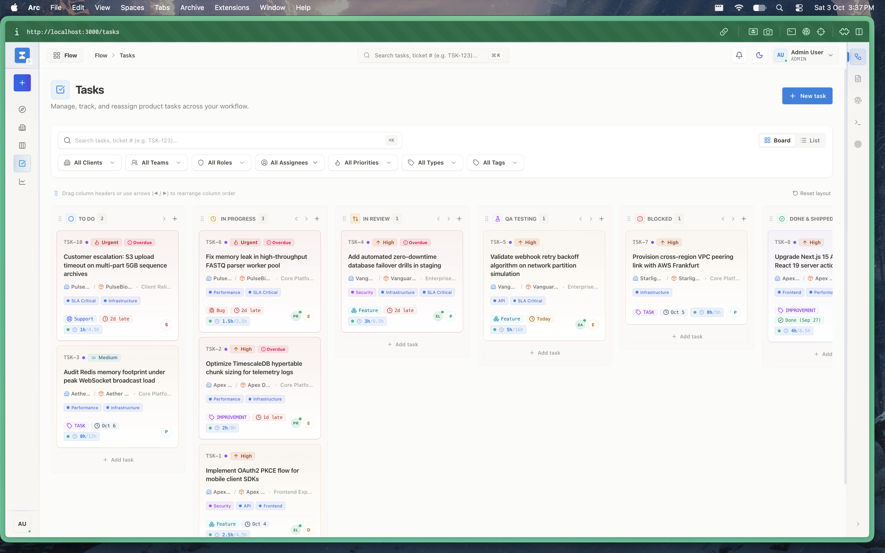

- **Workflow Stages**: `Backlog` ➔ `In Progress` ➔ `In Review` ➔ `Completed`.
- **Card Metadata**: Displays priority badges (Urgent, High, Medium, Low), assignee avatars, logged vs. estimated time chips, and ticket IDs (`TSK-xxx`).

---

### 3. High-Density Task List & Filter Matrix
For power users triaging dozens of tickets, the tabular view delivers instant sorting, status filters, and assignee breakdowns.

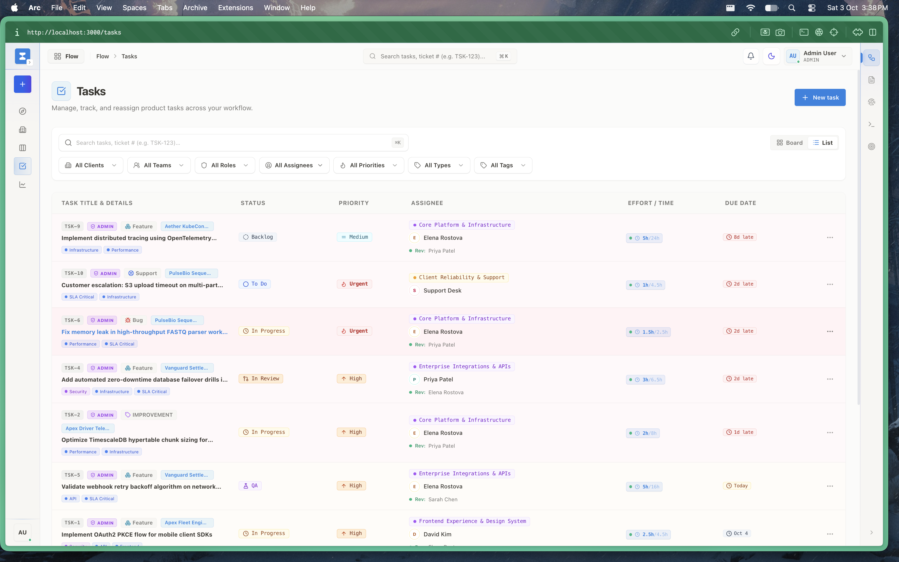

- **Multi-Parameter Search**: Instant client-side search across task titles, descriptions, and ticket numbers.
- **Faceted Filters**: Segment by Client, Team, Role, Priority, or Milestone.

---

### 4. Create Task Dialog
A streamlined modal to capture full ticket specifications without leaving the active context.

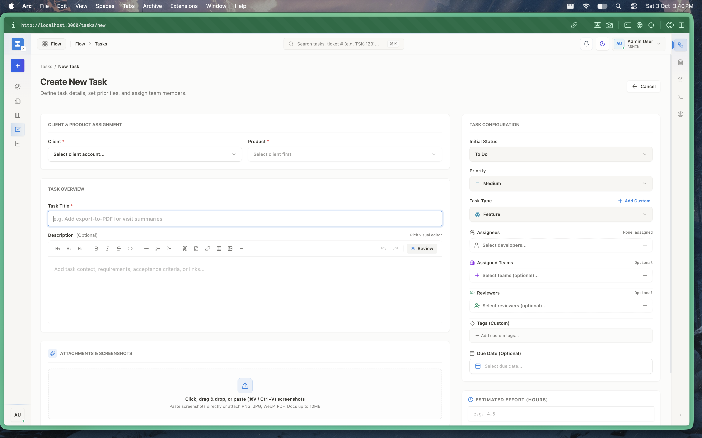

- **Client & Product Assignment**: Direct foreign-key linkage between enterprise clients, digital products, and sprint milestones.
- **Initial Configuration**: Set priority, estimated hours, due date, initial tags, and assignees.

---

### 5. Task Detail & AI Management Summary
The deep-dive ticket workbench provides rich context, status transitions, and automated AI assistance.

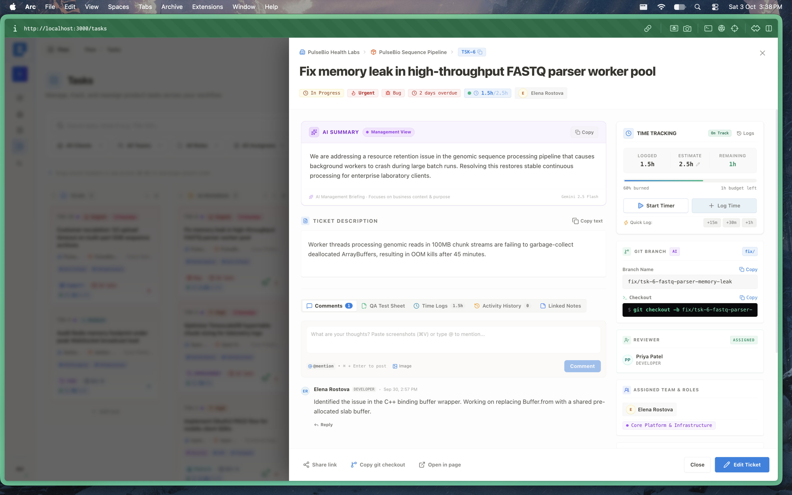

- **AI Task Summaries**: Context-aware summary cards extracting critical blockers, technical objectives, and executive action items.
- **Metadata Management**: Real-time updates for assignees, priority indicators, and milestone associations.

---

### 6. Active Stopwatch & Time Logs
Engineers can log hours directly against tickets to ensure billing transparency and sprint capacity accuracy.

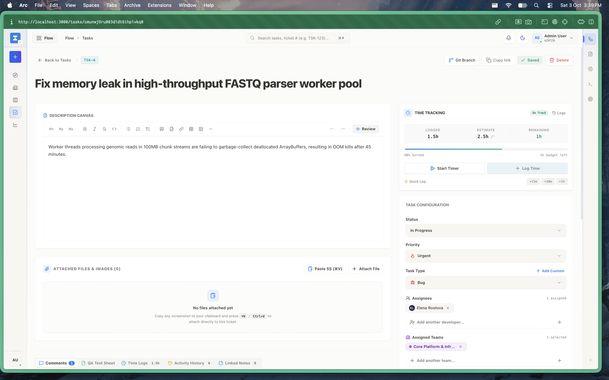

- **Global Active Timer**: Start, pause, and submit active timer sessions with live second-by-second updates.
- **Historical Intervals**: Detailed log breakdown of individual time sessions, logged dates, and notes.

---

### 7. Rich Markdown Description Canvas
Task descriptions feature full formatted text, code blocks, checklists, and dynamic embeds.

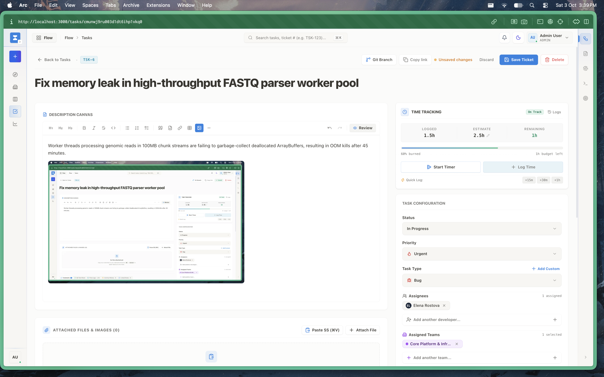

- **Rich Text & GFM Markdown**: Seamless switching between formatted preview and live WYSIWYG editing.
- **Change Tracking**: Dedicated `Unsaved Changes` indicator with quick `Save Ticket` and `Discard` safeguards.

---

### 8. Git Branch Helper & Developer Tools
Bridges the gap between project management and version control systems like GitHub and GitLab.

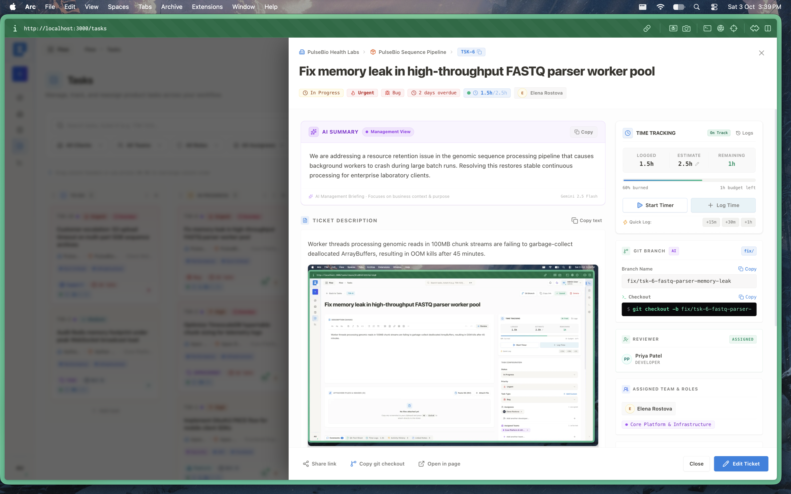

- **Deterministic Branch Naming**: Generates standard branch strings such as `feature/TSK-6-fix-memory-leak-fast-q-parser`.
- **One-Click Clipboard**: Instant copy button formatted for `git checkout -b <branch>` shell execution.

---

### 9. Enterprise Client Accounts Directory
Maintain customer accounts, stakeholder contacts, and service tiers across your entire client base.

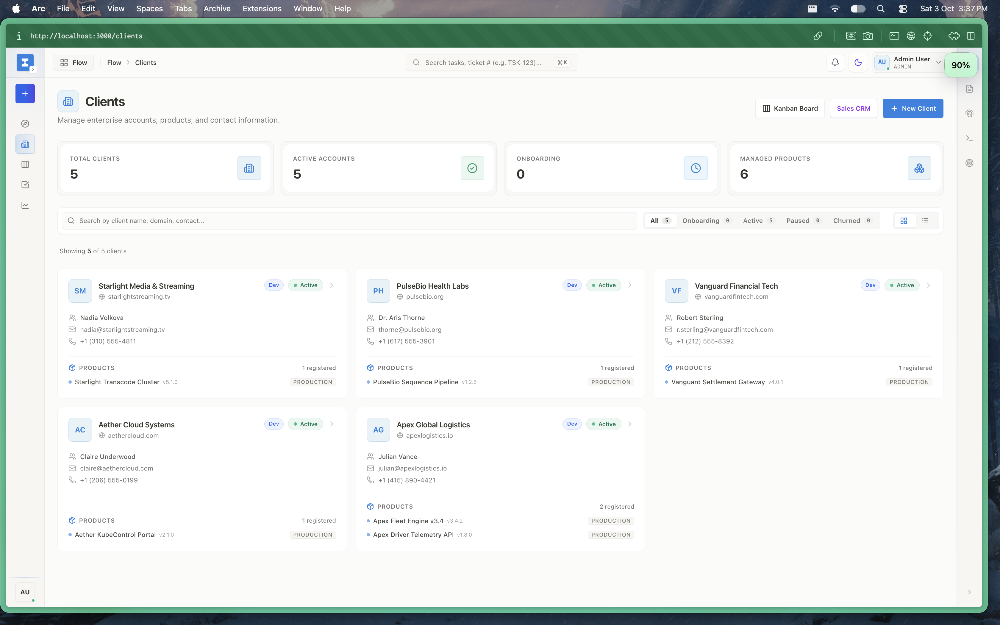

- **Client Metrics**: Total active accounts, onboarding status counts, and managed software product links.
- **Account Health**: Domain associations, primary account manager tags, and active contract indicators.

---

### 10. Client Delivery Pipeline Kanban
A strategic high-level pipeline monitoring enterprise clients from sales handover through onboarding and ongoing delivery.

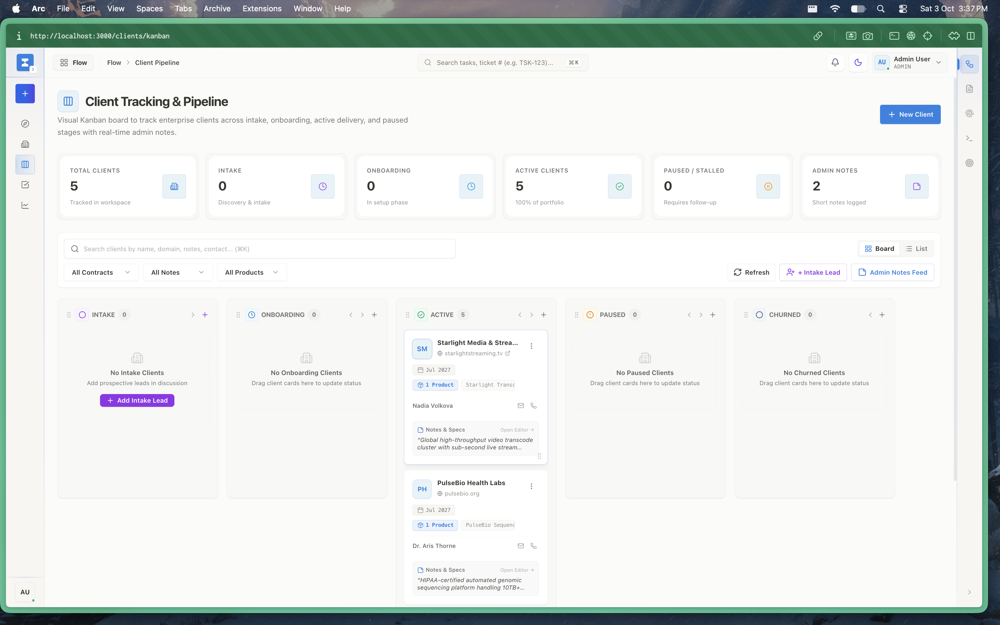

- **Stages**: `Intake` ➔ `Onboarding` ➔ `Active Delivery` ➔ `Paused / Stalled`.
- **Executive Admin Notes**: Direct inline annotations on client milestones and escalation statuses.

---

### 11. Client Detail View & SLA Delivery Matrix
Detailed analytics for individual client accounts showing team velocity, SLA health, and active work orders.

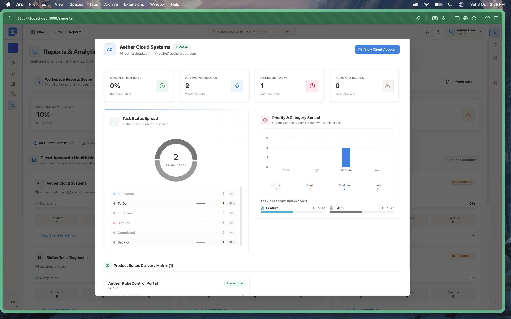

- **Account SLA Scorecards**: Completion rate percentages, active engineering burn rates, and open issue counts.
- **Product Hierarchy**: Direct navigation into client-specific products and associated sprint boards.

---

### 12. Workspace Reports & Team Delivery Metrics
Aggregated delivery metrics across all teams and departments.

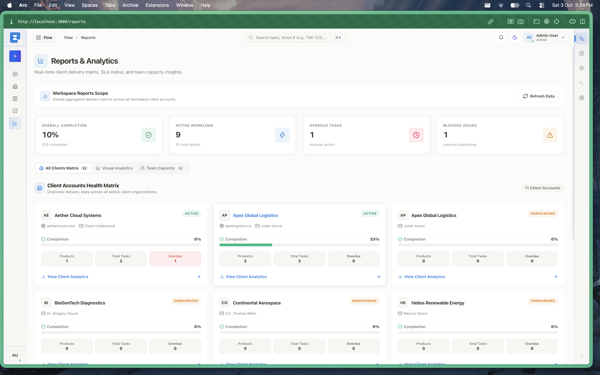

- **Aggregated Analytics**: Workload completion graphs, overdue task warnings, and blocker rate trends.
- **Export & Refresh**: Instant live refresh with CSV/PDF reporting capabilities.

---

### 13. User Profile & Credential Settings
Personalized workbench settings allowing team members to configure credentials, notifications, and visual preferences.

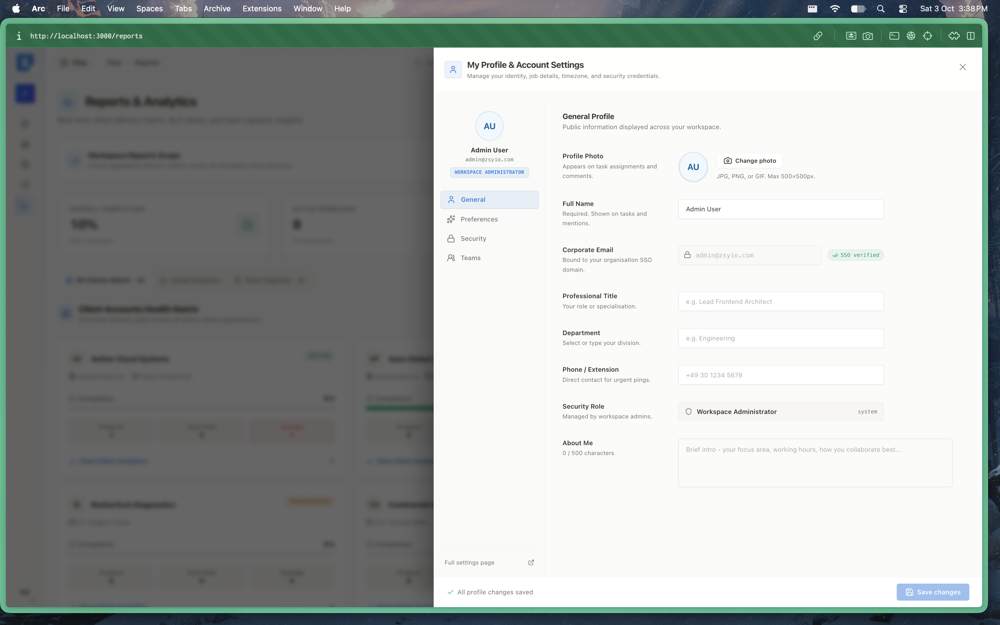

- **Identity Information**: Name, enterprise email, avatar upload, and timezone synchronization.
- **Theme Preferences**: Instant toggle between Dark, Light, and System theme modes.

---

## 6. Technical Architecture & Implementation

- **Framework**: Next.js 15 (App Router), React 19, TypeScript.
- **State Management**: Redux Toolkit Query (`tasksApi`, `clientsApi`, `timeEntriesApi`).
- **Database Models (Prisma)**:
  - `Task`: Core task record with status, priority, estimated hours, and due dates.
  - `TimeEntry`: Fine-grained work session logs with start/end timestamps and descriptions.
  - `Client`: Enterprise organization entity with domains and SLAs.
  - `Product`: Software deliverables associated with clients and tasks.
- **Design Tokens**: Strict usage of `@zsyio/ui` design primitives (`tokens.css`, `button.tsx`, `kpi-card.tsx`).
- **Security & Integrity**: All actions are validated against `@zsyio/validators` schemas and authenticated through `@zsyio/auth` middleware.
