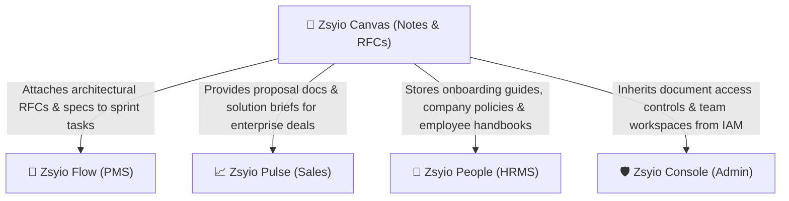
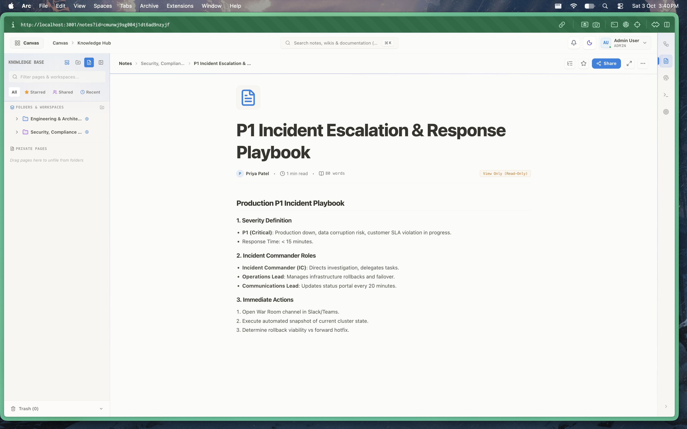
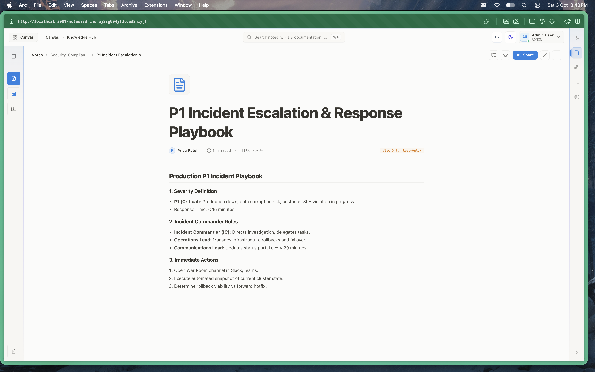
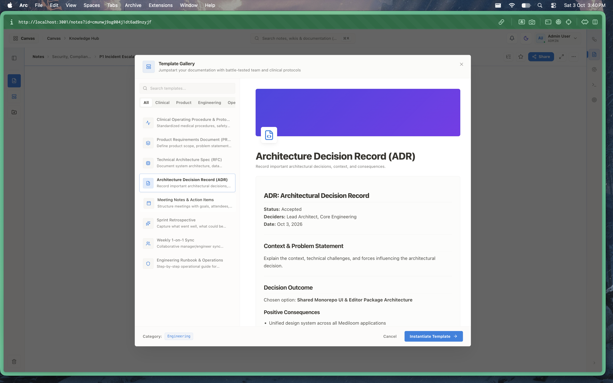
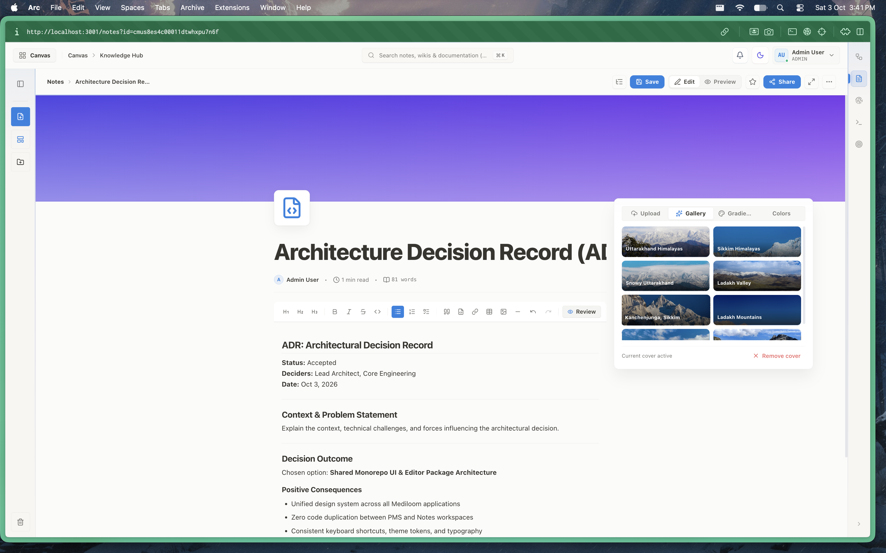
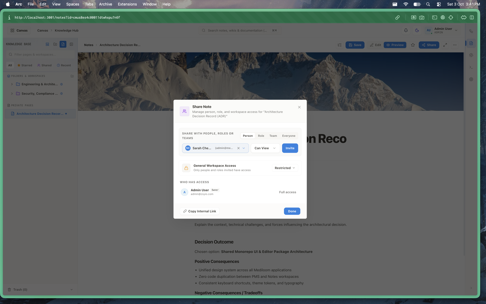
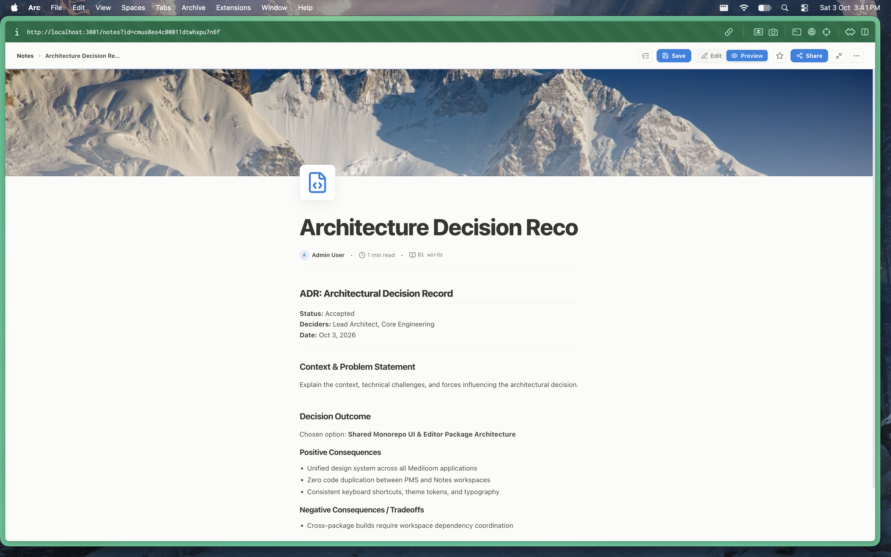

# Zsyio Canvas — Knowledge Base, RFCs & Architectural Documentation

> **The Collaborative Architecture & Engineering Knowledge Platform of the Zsyio Operating System**

---

## 1. What is Zsyio Canvas?

**Zsyio Canvas** (also known as *Zsyio Notes*) is the centralized intelligence and architectural documentation platform of the Zsyio Suite. Designed to serve engineering leads, software architects, product managers, and security auditors, it provides a high-density, real-time documentation canvas equipped with native support for live interactive architecture diagrams.

Zsyio Canvas replaces disconnected documents with a single repository for:
- Engineering RFCs (Request for Comments) and Architectural Decision Records (ADRs).
- High-pressure P1 Incident Escalation & Response Runbooks.
- Live Mermaid.js architecture diagrams with zoom, pan, SVG export, and code toggle.
- Categorized workspace hierarchies, starred team pages, and pre-built document templates.

---

## 2. Why Are We Using It? (The Problem It Solves)

Engineering organizations frequently suffer from **tribal knowledge decay and documentation rot**:
- **Disjointed wiki silos**: Teams write docs in Google Docs, Notion, or Confluence, while architecture diagrams live in Lucidchart or Miro. When code changes, the external diagrams quickly become obsolete.
- **Diagrams disconnected from code**: Traditional tools embed static image exports of diagrams. In Zsyio Canvas, architecture diagrams are written in declarative Mermaid code that can be updated in seconds right inside the document.
- **Inconsistent emergency playbooks**: During critical P1 outages, engineers waste precious minutes hunting for runbooks scattered across Slack or email threads. Canvas centralizes standard operating procedures with verified readouts.
- **Enterprise SaaS license sprawl**: Paying $10–$25/user/month for Notion or Confluence alongside diagramming subscriptions like Lucidchart ($9/user/month).

### What Zsyio Canvas Replaces:
- **Notion / Atlassian Confluence / Coda** for knowledge base and team documentation.
- **Lucidchart / Miro / Draw.io** for technical flowcharts and sequence diagrams.
- **Google Docs** for internal RFCs and retrospective notes.

---

## 3. Who Is This App For? (Target Personas)

| Persona | Role in Organization | How They Use Zsyio Canvas |
| :--- | :--- | :--- |
| **Principal Architects & Tech Leads** | System Architects, Staff Engineers | Drafts Architectural Decision Records (ADRs), creates Mermaid system diagrams, and reviews technical proposals. |
| **Software Engineers** | Frontend, Backend, Infrastructure | References API contracts, reads deployment runbooks, and documents feature implementations. |
| **Site Reliability & DevOps Leads** | SREs, Incident Commanders | Authors P1 incident playbooks, documents on-call escalation policies, and logs post-mortem reviews. |
| **Product & Program Managers** | Technical PMs, Product Leads | Prepares product requirement documents (PRDs), milestone definitions, and sprint retro notes. |
| **Security & Compliance Auditors** | InfoSec, Compliance Officers | Reviews data protection policies, disaster recovery plans, and SOC 2 / ISO documentation. |

---

## 4. How Zsyio Canvas Connects With Other Apps

Zsyio Canvas serves as the foundational knowledge library for the entire Zsyio monorepo:

1. **Zsyio Flow (Project Management Suite)**:
   - Sprint tasks in Flow link directly to ADRs and technical specifications authored in Canvas, ensuring developers build against vetted architectural standards.
2. **Zsyio Pulse (Sales CRM)**:
   - Sales reps reference technical capability whitepapers and compliance RFCs stored in Canvas during complex RFP and enterprise deal negotiations.
3. **Zsyio People (HRMS & Attendance)**:
   - Corporate holiday policies, employee handbooks, and leave guidelines written in Canvas are surfaced directly to employees in Zsyio People.
4. **Zsyio Console (Central Admin & IAM)**:
   - Document permissions (Read-Only, Commenter, Editor, Workspace Admin) and private folder clearances are strictly authenticated via Console's Zero-Trust directory.

---

## 5. Visual Walkthrough & Interface Guide

### 1. Knowledge Base Workspace & Folders
The primary knowledge repository sidebar categorizes corporate intelligence into discoverable workspaces and topic hierarchies.

- **Hierarchical Navigation**: Quick access to Starred documents, Shared documents, and Recent pages.
- **Workspace Taxonomy**: Structured workspaces for *Engineering & Architecture*, *Security & Compliance*, *Product Specifications*, and *Operations*.
- **Quick Search & Filter**: Real-time client-side search across notes, titles, and body content.

---

### 2. Live Document View — P1 Incident Response Playbook
A distraction-free reading experience optimized for high-pressure operational situations.

- **Header Metadata**: Shows author attribution, last modified timestamp, estimated reading time, and word count.
- **Access Badging**: Clear indicators for `Read-Only` or `Edit Mode` based on user permissions.
- **Action Toolbar**: One-click sharing, document starring, and export triggers.

---

### 3. Enterprise Template Gallery
Jumpstart team documentation with standard formats that maintain consistency across engineering and operations.

- **Curated Presets**: Architectural Decision Records (ADR), Engineering RFCs, P1 Escalation Runbooks, Sprint Retrospectives, and Clinical Protocols.
- **Faceted Categorization**: Filter templates by Product, Engineering, Clinical, or Operations domains.
- **Instant Scaffolding**: Clones pre-formatted headings, checklists, and diagram blocks with a single click.

---

### 4. Document Cover & Header Customizer
Elevate documentation aesthetics with customizable covers, gradients, and icons.

- **Custom Cover Images**: Choose from curated high-resolution photographic banners, minimalist geometric patterns, or custom uploads.
- **Gradient Accents**: Synchronized palette options that align with dark and light theme tokens.
- **Icon Selector**: Semantic emojis and SVG icon badges to distinguish document types at a glance.

---

### 5. Collaborative Document Workspace & Outline
A dual-pane authoring workbench combining hierarchical navigation with in-depth document editing.

- **Dynamic Outline**: Automatically generated Table of Contents based on H1, H2, and H3 headings.
- **Breadcrumb Navigation**: Shows the complete ancestral path (`Notes > Security > Incident Escalation`) for effortless navigation.

---

### 6. Architectural Decision Record (ADR) Editor
The flagship technical writing interface supporting engineering RFCs and architectural decisions.

- **Structured ADR Schema**: Native fields for Context, Decision, Status (Accepted / Proposed / Deprecated), Deciders, and Consequences.
- **Live Diagram Integration**: Seamlessly render Mermaid.js architecture diagrams alongside implementation specifications.
- **Live Auto-Save**: Background debounce saves changes automatically while providing explicit manual save safeguards.

---

## 6. Technical Architecture & Implementation

- **Framework**: Next.js 15 (App Router), React 19, TypeScript.
- **Editor Engine**: Custom `@zsyio/editor` package built on Tiptap v2, ProseMirror, and Mermaid.js.
- **Database Models (Prisma)**:
  - `Note`: Core document record storing title, slug, content (JSON/markdown), cover image, icon, and tags.
  - `NotePermission`: Explicit user/team permission grants (`VIEW`, `COMMENT`, `EDIT`, `ADMIN`).
  - `NoteTemplate`: Reusable boilerplate schemas for engineering and operations.
  - `Team`: Organizational ownership linkage.
- **Aesthetic Principles**: Compliant with Antislop UI guidelines — clean typography (`Inter`, `JetBrains Mono`), accessible contrast, and zero raw hex colors.
