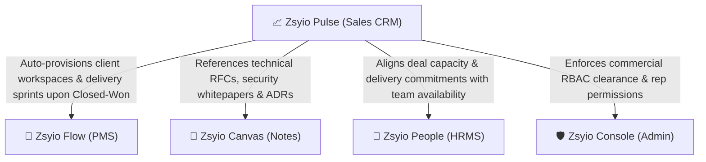
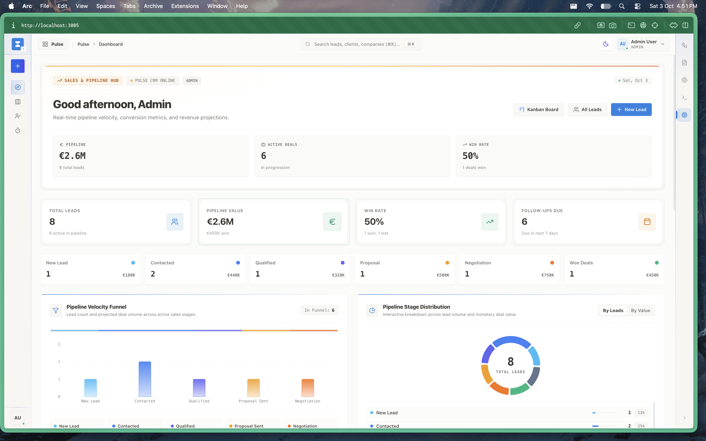
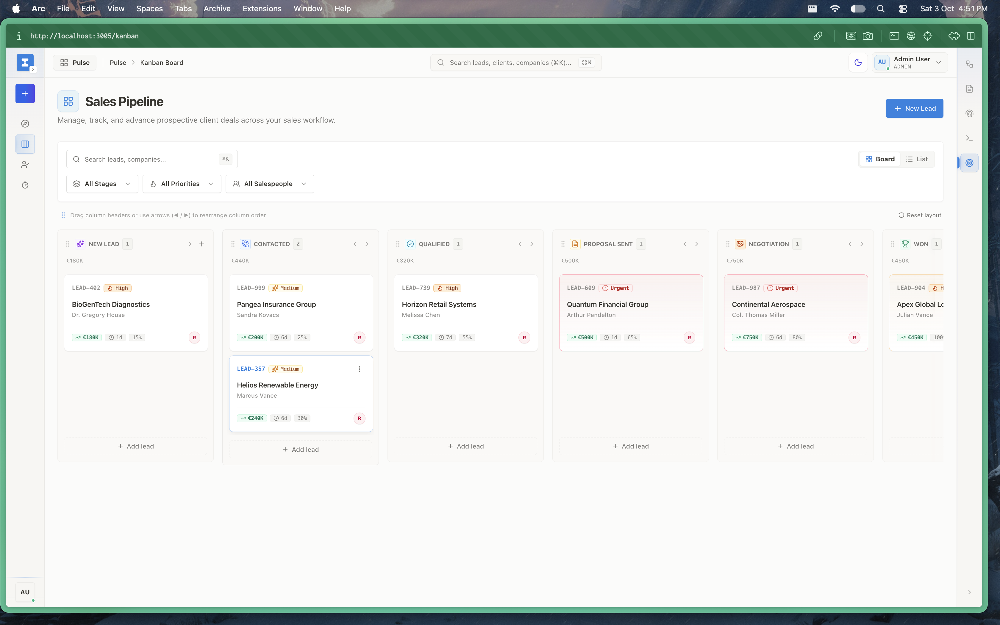
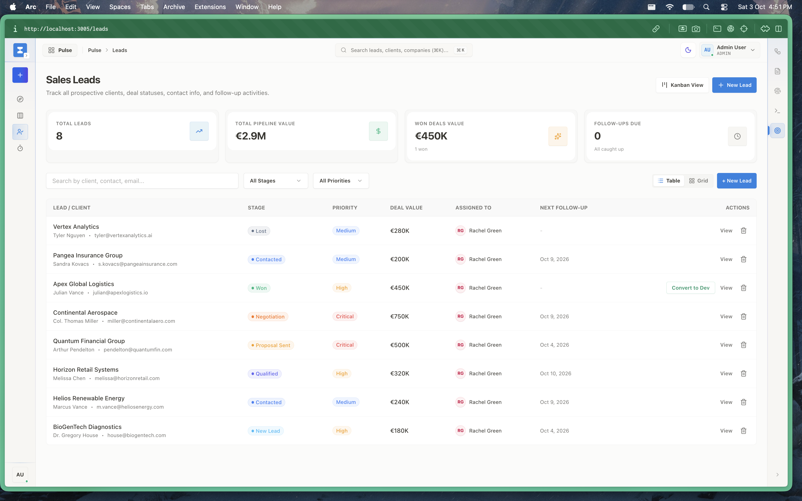
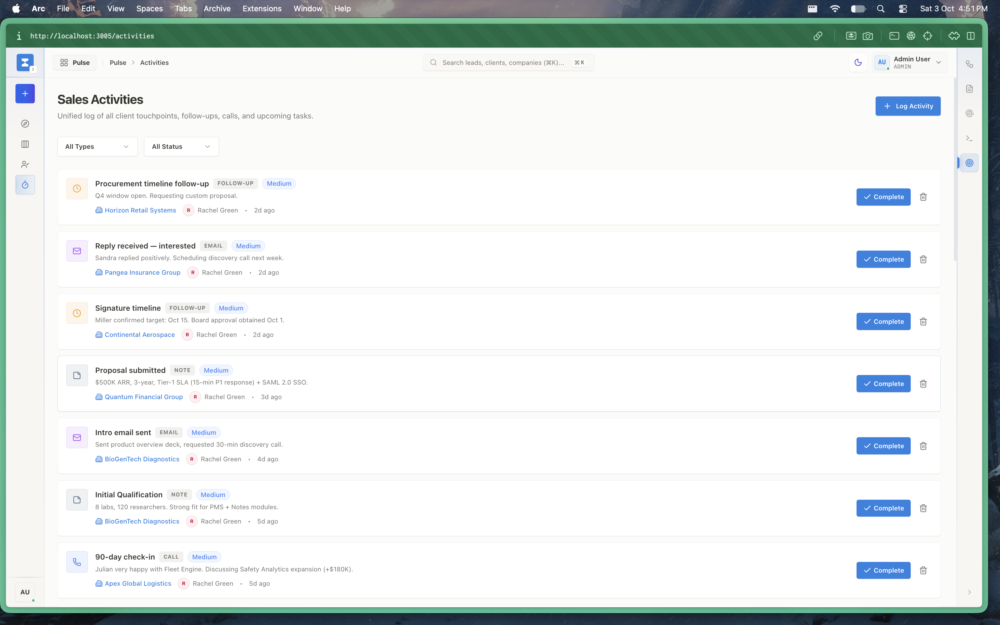

# Zsyio Pulse — Enterprise Sales CRM & Pipeline Hub

> **The Commercial Engine & Revenue Acceleration Platform of the Zsyio Operating System**

---

## 1. What is Zsyio Pulse?

**Zsyio Pulse** (also known as *Zsyio Sales*) is the commercial customer relationship management (CRM) and pipeline execution engine of the Zsyio Suite. Built to empower enterprise account executives, sales development representatives (SDRs), and revenue leaders, it streamlines client acquisition from initial prospect capture to multi-million-dollar deal closure.

Unlike bloated, legacy enterprise CRMs that require months of custom configuration, Zsyio Pulse offers an agile, high-density revenue workbench that includes:
- Real-time pipeline velocity scorecards and forecasted deal values ($2.9M+ pipeline visibility).
- A multi-stage drag-and-drop Deals Kanban board with stage-by-stage revenue rollups.
- A centralized corporate leads directory with contact intelligence and status tags.
- Detailed chronological activity logs tracking executive calls, demos, proposals, and procurement milestones.

---

## 2. Why Are We Using It? (The Problem It Solves)

Commercial operations in technology organizations frequently suffer from **operational disconnection and CRM bloat**:
- **Disconnection between Sales and Engineering**: Sales reps close deals in Salesforce or HubSpot, but engineering delivery teams work in Jira. Critical client commitments, custom feature promises, and delivery dates get lost during the handover.
- **Overwhelming CRM complexity**: Traditional enterprise CRMs like Salesforce are notoriously complex, cluttered with hundreds of irrelevant fields that sales reps actively avoid updating.
- **Lost client touchpoints**: Client emails, call notes, and procurement deadlines get buried in individual sales rep inboxes. When an account executive transitions, account history is lost.
- **Punitive SaaS licensing**: Salesforce Enterprise costs $165–$330/user/month, creating an artificial barrier where only a few team members are granted access.

### What Zsyio Pulse Replaces:
- **Salesforce Sales Cloud / HubSpot Sales Hub / Pipedrive** for lead capture, pipeline tracking, and deal stages.
- **Salesloft / Outreach** for logging sales activities and client touchpoints.

---

## 3. Who Is This App For? (Target Personas)

| Persona | Role in Organization | How They Use Zsyio Pulse |
| :--- | :--- | :--- |
| **Vice President of Sales & CRO** | Revenue Executives | Monitors quarterly revenue projections, win/loss conversion rates, and team pipeline velocity. |
| **Enterprise Account Executives (AEs)** | Senior Sales Reps | Moves enterprise opportunities through negotiation stages, logs executive meetings, and closes contracts. |
| **Sales Development Reps (SDRs)** | Inbound/Outbound Prospectors | Captures new corporate leads, qualifies purchasing intent, and schedules technical demos. |
| **Solutions Architects & Sales Engineers** | Technical Pre-Sales | Reviews prospective deal requirements and prepares architectural proposals aligned with client SLAs. |

---

## 4. How Zsyio Pulse Connects With Other Apps

Zsyio Pulse bridges commercial revenue goals directly with delivery and governance across the monorepo:

1. **Zsyio Flow (Project Management Suite)**:
   - When a deal is dragged into the `Closed Won` stage in Pulse, an automated trigger provisions the enterprise account, contacts, and delivery boards in Flow, eliminating manual sales-to-engineering handoff friction.
2. **Zsyio Canvas (Knowledge Base & RFCs)**:
   - Sales reps directly reference product RFCs, architectural specifications, and security compliance runbooks in Canvas to rapidly answer client RFP inquiries.
3. **Zsyio People (HRMS & Attendance)**:
   - Account managers check engineering delivery bandwidth in People before committing to aggressive client rollout timelines.
4. **Zsyio Console (Central Admin & IAM)**:
   - Confidential deal values, pipeline projections, and customer contact data are protected by Console's strict commercial RBAC permissions.

---

## 5. Visual Walkthrough & Interface Guide

### 1. Sales & Pipeline Executive Hub
The mission control for commercial leadership and account managers providing real-time pipeline visibility.

- **Revenue Projections**: Real-time pipeline velocity, forecasted earnings, and quarterly targets.
- **Action Triggers**: Quick actions to log new leads, record client activities, or switch into the active deals board.
- **Live CRM State**: Displays online sync status and user role clearance.

---

### 2. Multi-Stage Deals Pipeline Kanban
A tactile board allowing sales reps to navigate opportunities through complex enterprise qualification cycles.

- **Standard Sales Stages**: `Discovery` ➔ `Qualified` ➔ `Proposal` ➔ `Negotiation` ➔ `Closed Won` / `Closed Lost`.
- **Deal Cards**: Displays deal value ($), primary company name, contact person, expected close date, and risk badges.
- **Drag-and-Drop Velocity**: Instant stage updates with automatic recalculation of stage totals.

---

### 3. Leads Directory & Pipeline Scorecard
The detailed directory of corporate accounts, procurement leads, and inbound prospects.

- **Key Scorecards**:
  - `Total Leads`: Active count of tracked prospects.
  - `Total Pipeline Value`: Aggregate unweighted pipeline ($2.9M+).
  - `Won Deals Value`: Booked revenue to date ($450K+).
  - `Follow-ups Due`: Critical attention counter preventing deal slippage.
- **Search & Filter**: Instant filtering by company name, contact email, deal size, or lead status.

---

### 4. Sales Activities & Touchpoints Log
Chronological audit trail of all client interactions and pending customer milestones.

- **Touchpoint Categories**: Phone calls, email correspondence, executive demos, and procurement timeline follow-ups.
- **Priority & Status Tracking**: High, Medium, and Low urgency indicators with completion checkboxes.
- **Company Association**: Direct linkage to company records (e.g., *Horizon Retail Systems*).

---

## 6. Technical Architecture & Implementation

- **Framework**: Next.js 15 (App Router), React 19, TypeScript.
- **State & Data Layer**: Redux Toolkit Query (`salesApi`) with optimistic updates on drag-and-drop stage changes.
- **Database Models (Prisma)**:
  - `Lead`: Prospective client entity storing company, contact name, email, estimated deal value, and stage.
  - `LeadActivity`: Interaction notes, meeting records, scheduled reminders, and completion statuses.
  - `Deal`: Structured contract opportunities associated with target enterprise accounts.
- **Design Tokens**: Standardized `@zsyio/ui` components (`card.tsx`, `status-badge.tsx`, `kanban-card.tsx`).
- **Aesthetic Principles**: Full compliance with zero-raw-colors contracts and dark/light mode synchronization.
