# Zsyio People — Enterprise HRMS, Attendance & Workforce Operations

> **The Human Capital, Attendance & Operational Presence Engine of the Zsyio Operating System**

---

## 1. What is Zsyio People?

**Zsyio People** (also known as *Zsyio HRMS*) is the human capital management and attendance tracking platform of the Zsyio Suite. Designed to support both everyday employees and organizational People Operations (HR) specialists, it bridges individual work sessions with corporate workforce planning.

Zsyio People streamlines:
- Digital punch station clock-in / clock-out tracking with active session monitors and break controls.
- Granular personal timesheets (daily interval logs, weekly summaries, and monthly attendance calendars).
- Automated leave accounting across Paid Time Off (PTO), Sick Leave, and Casual balances with manager approval workflows.
- Live team presence monitoring showing who is currently working, on break, or off duty.
- Annual holiday schedules and organization-wide work rule enforcement (40h/week shift targets and half-day cutoffs).

---

## 2. Why Are We Using It? (The Problem It Solves)

Workforce management in technology firms is often plagued by **clunky standalone HR portals, manual time disputes, and lack of real-time presence**:
- **Disconnection between daily engineering work and HR systems**: Employees do technical work in GitHub and Jira, but have to log into an entirely separate clunky HR portal (BambooHR, Workday) just to clock in or apply for time off.
- **Inaccurate project allocation and billing**: When engineers take sick leave or vacations, sprint leads in Jira don't find out until after the sprint begins, leading to missed deadlines and overtime spikes.
- **Manual timesheet disputes**: Paper or spreadsheet timesheets lead to errors, lost break records, and end-of-month payroll headaches.
- **Costly HR software licensing**: Standalone HRMS platforms cost $8–$20/employee/month with heavy setup overhead.

### What Zsyio People Replaces:
- **BambooHR / Rippling / Workday / Gusto** for employee directories, leave requests, and company calendars.
- **Time Doctor / Deputy / TSheets** for digital punch stations and attendance tracking.

---

## 3. Who Is This App For? (Target Personas)

| Persona | Role in Organization | How They Use Zsyio People |
| :--- | :--- | :--- |
| **All Organization Employees** | Engineers, Designers, Marketers | Clocks in/out daily, manages lunch/rest breaks, reviews personal timesheets, and applies for leaves. |
| **Department Leads & Managers** | Engineering Leads, Team Managers | Reviews and approves leave applications, monitors real-time team presence, and adjusts shift regularizations. |
| **People Operations (HR Admins)** | HR Managers, People Officers | Configures annual holiday calendars, adjusts company leave policies, and oversees compliance auditing. |
| **Finance & Payroll Officers** | Payroll Specialists | Exports monthly verified attendance and overtime logs directly into payroll processing pipelines. |

---

## 4. How Zsyio People Connects With Other Apps

Zsyio People ensures that the human capacity of the organization is accurately mirrored across all tools:

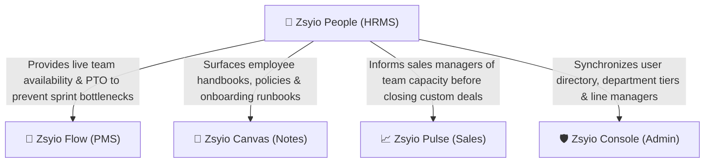

1. **Zsyio Flow (Project Management Suite)**:
   - When a project manager assigns a task in Flow, the assignee selector indicates whether the developer is currently active, on break, or on leave in People, preventing sprint bottlenecks.
2. **Zsyio Canvas (Knowledge Base & RFCs)**:
   - Official HR documentation, employee benefits guides, and compliance policies authored in Canvas are directly linked within People's help menus.
3. **Zsyio Pulse (Sales CRM)**:
   - Commercial managers can assess technical delivery capacity in People before committing engineering resources to high-urgency client deadlines.
4. **Zsyio Console (Central Admin & IAM)**:
   - Department managers and team hierarchies established in Console automatically determine leave approval routing and permissions in People.

---

## 5. Visual Walkthrough & Interface Guide

### 1. Attendance & Punch Station Dashboard
The daily starting point for every team member to manage their active working sessions and daily goals.

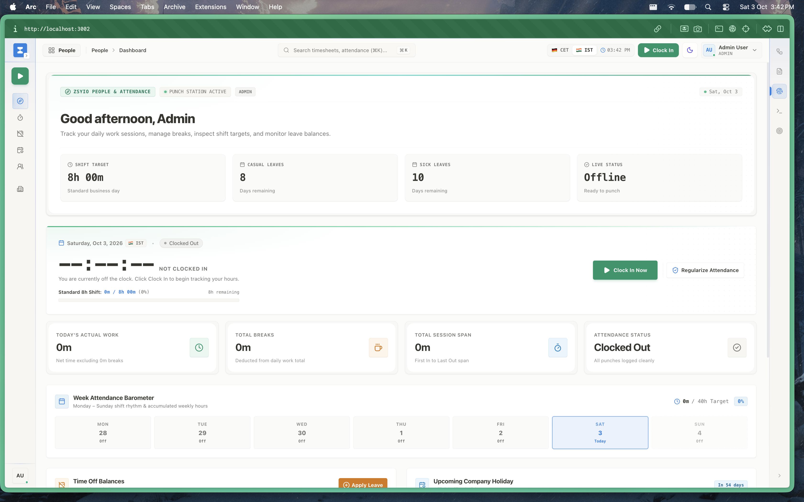

- **Punch Controls**: One-click Clock-In / Clock-Out and Break management station.
- **Daily Targets**: Live comparison against daily shift targets (8 hours) with real-time session progress.
- **Leave Balances**: Instant preview of remaining Casual and Sick leave balances.

---

### 2. People Operations & Session Tracker
Executive overview of workforce activity, attendance health, and upcoming organizational events.

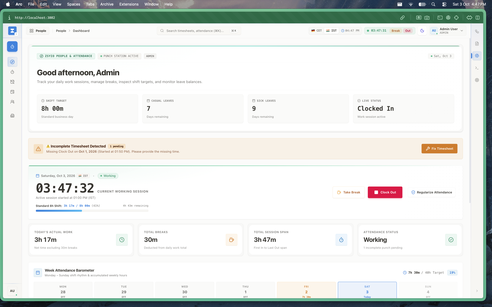

- **Shift Target Status**: Tracks adherence to daily and weekly operational shifts.
- **Personal Balances**: Quick widgets showing available paid time off and compensatory off days.

---

### 3. Personal Timesheet & Activity Hub
Detailed daily working intervals and historical timesheet auditing.

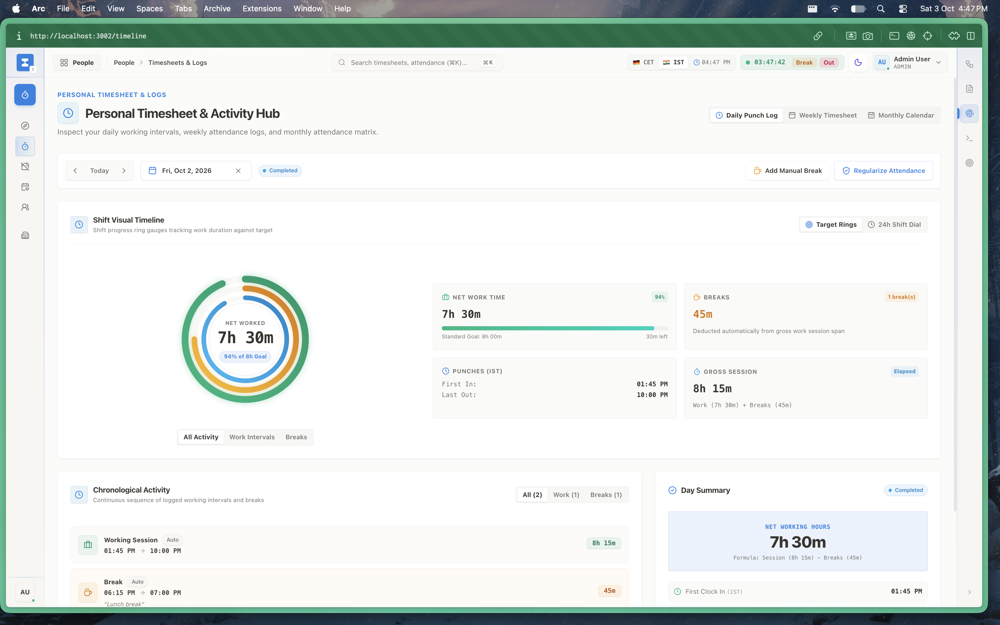

- **Views**: Switch effortlessly between *Daily Punch Log*, *Weekly Timesheet*, and *Monthly Calendar*.
- **Interval Breakdown**: Precise timestamps of work commencement, break intervals, and clock-out times.
- **Manual Adjustments**: Ability to log manual breaks or request attendance regularizations.

---

### 4. Monthly Working Hours & Overtime Metrics
Comprehensive monthly performance metrics tracking total hours against corporate shift requirements.

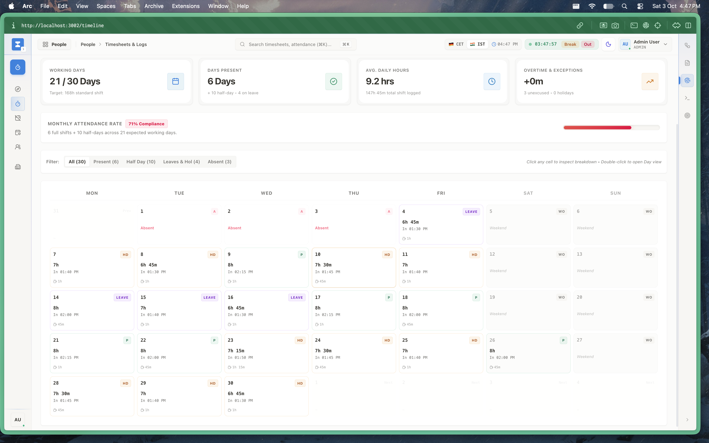

- **Key Scorecards**:
  - `Working Days`: Days elapsed in month (e.g. 21 / 30).
  - `Days Present`: Total active workdays logged.
  - `Avg Daily Hours`: Real average working velocity (e.g. 9.2 hrs/day).
  - `Overtime & Exceptions`: Net overtime accumulated above the 168h standard shift.

---

### 5. Shift Interval & Break Detail Breakdown
Deep-dive inspection into specific work days and attendance exception states.

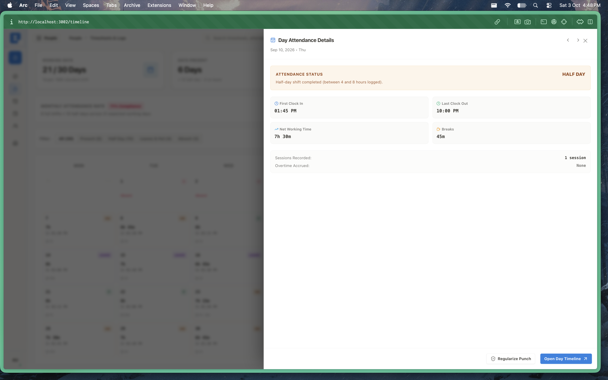

- **Shift Classification**: Automatic evaluation of status (`Full Day`, `Half Day`, `Absent`, `On Leave`).
- **Timing Stamps**: First clock-in, last clock-out, net working time, and net break durations.

---

### 6. Time Off & Leave Management Quotas
Self-service portal for employees to review leave allowances and submit planned time-off requests.

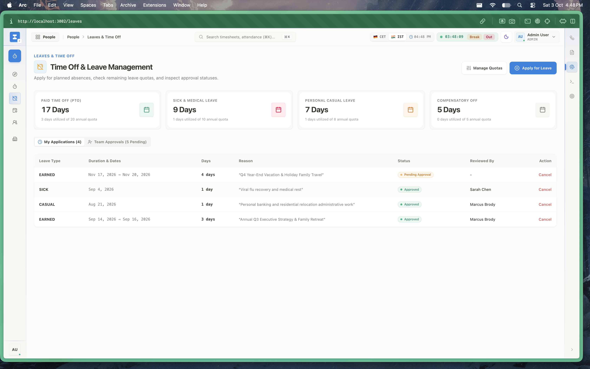

- **Quota Categories**: Paid Time Off (PTO), Sick & Medical Leave, Personal Casual Leave, and Compensatory Off.
- **Balance Ledger**: Clear counters showing granted days, utilized days, and remaining balances.

---

### 7. Apply for Leave & Balances Matrix
Interactive leave application workflow ensuring smooth approvals and automated team calendar updates.

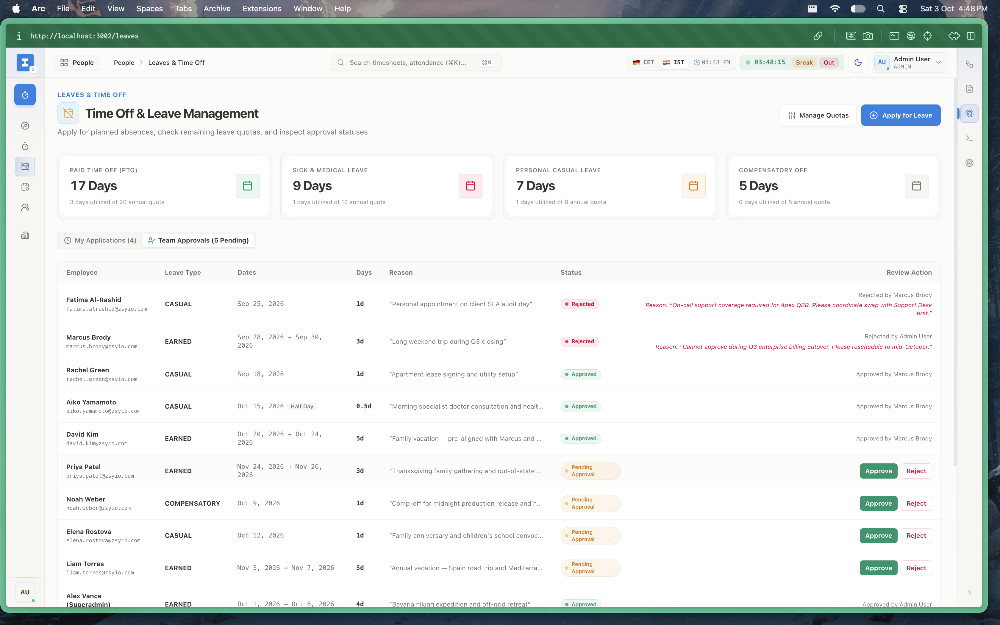

- **Application Form**: Select leave type, start/end dates, full-day or half-day flags, and mandatory justification notes.
- **Manager Approval Pipeline**: Direct routing to designated department leads for review.

---

### 8. Annual Holiday Calendar
Centralized schedule of company-wide recognized holidays and optional commemorations.

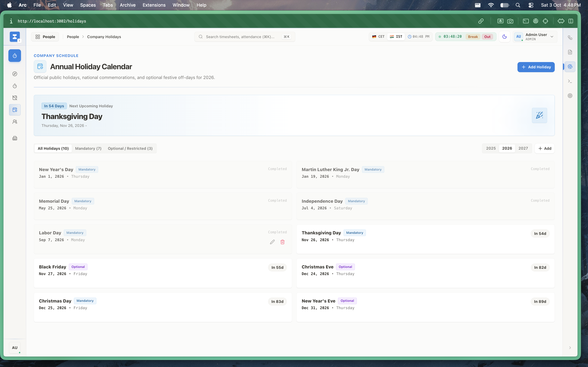

- **Upcoming Countdown**: Banner highlight showing the next upcoming holiday (e.g., Thanksgiving Day in 54 days).
- **Comprehensive Listing**: Chronological directory of all 10 standard corporate holidays for the active year.

---

### 9. Team Directory & Live Presence
Real-time roster showing live working statuses across the entire company.

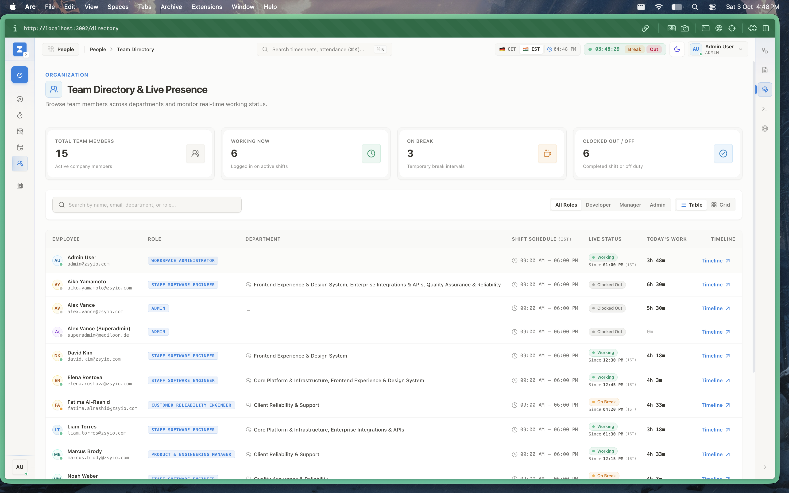

- **Presence Indicators**:
  - `Total Team Members`: 15 corporate accounts.
  - `Working Now`: Actively clocked-in employees.
  - `On Break`: Employees paused on rest breaks.
  - `Clocked Out / Off`: Inactive or on leave.

---

### 10. Team Directory Faceted Filters
Quick discovery tools to search and filter employees by department, designation, or working state.

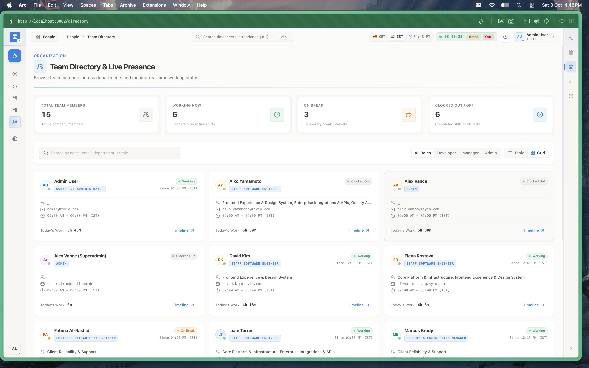

- **Department Categorization**: Filter by Engineering, Product, Commercial, HR, or Executive teams.
- **Direct Profiles**: Instant navigation into comprehensive employee profile records.

---

### 11. Organization Attendance & Timesheet Monitor
Administrative dashboard for HR operations to oversee company-wide attendance compliance.

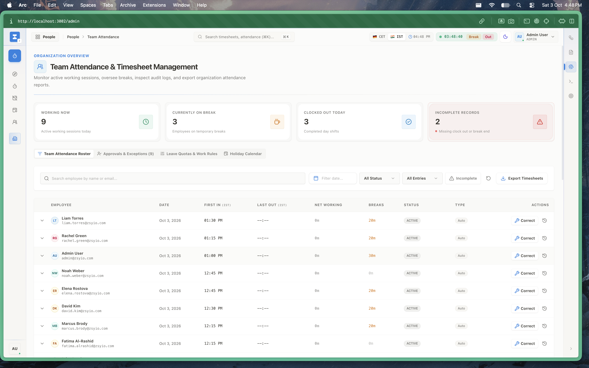

- **Compliance Auditing**: Identify incomplete records, missing clock-outs, and excessive break durations.
- **Reporting & Exports**: Export certified CSV attendance records for monthly payroll processing.

---

### 12. HR Policies, Work Rules & Leave Allocations
Administrative settings hub to configure company-wide attendance rules, quotas, and schedules.

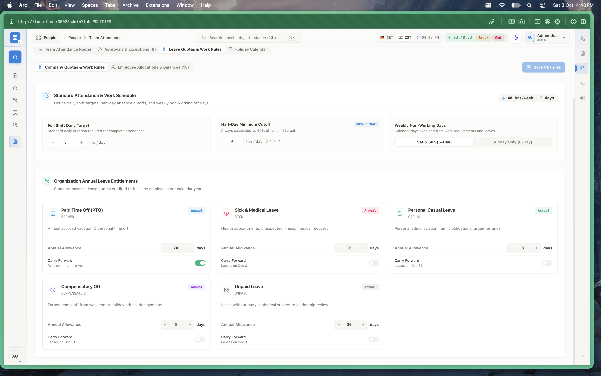

- **Standard Work Schedule**: Configurable 40 hrs/week 5-day parameters and shift target definitions.
- **Half-Day Cutoffs**: Automated threshold rules (e.g. 4-8 hours logged constitutes a half-day).
- **Employee Allocations**: Bulk allocation of leave balances and annual quota adjustments.

---

## 6. Technical Architecture & Implementation

- **Framework**: Next.js 15 (App Router), React 19, TypeScript.
- **State & Data Layer**: Redux Toolkit Query (`hrmsApi`, `attendanceApi`, `leaveApi`).
- **Database Models (Prisma)**:
  - `AttendanceRecord`: Daily clock-in/out stamps, status, and calculated net hours.
  - `BreakRecord`: Nested break intervals linked to daily attendance records.
  - `LeaveRequest`: Time off submissions with type, dates, reason, and approval state.
  - `LeaveBalance`: Employee balance ledger across PTO, Sick, and Casual quotas.
  - `Holiday`: Organization holiday definitions.
- **Design Tokens**: Standardized `@zsyio/ui` components (`status-badge.tsx`, `segmented-tabs.tsx`, `kpi-card.tsx`).
- **Data Integrity**: Attendance calculations strictly compute duration accounting for timezone offsets and break subtractions.
