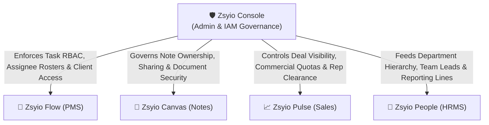
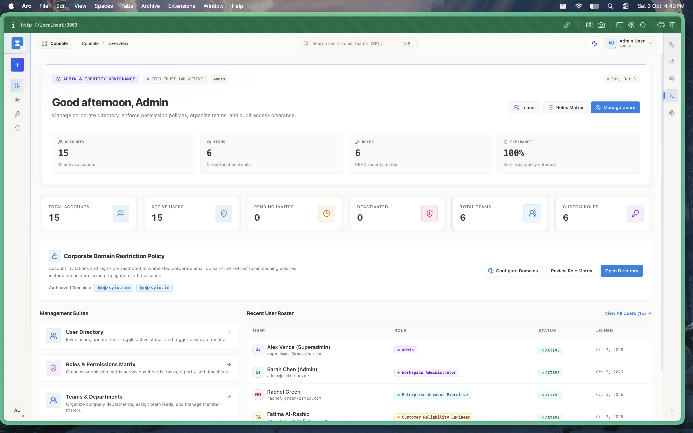
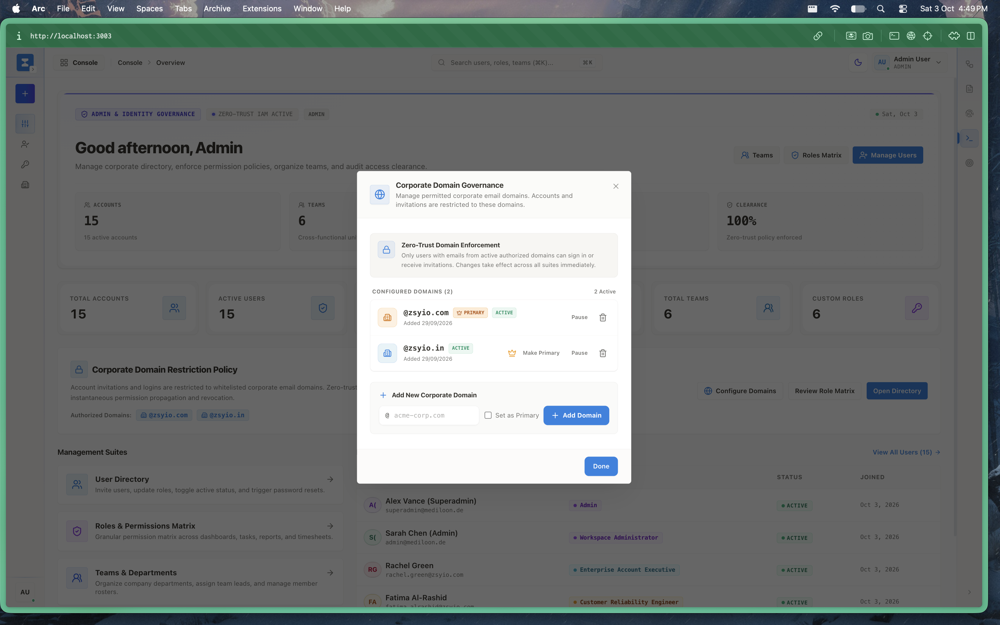
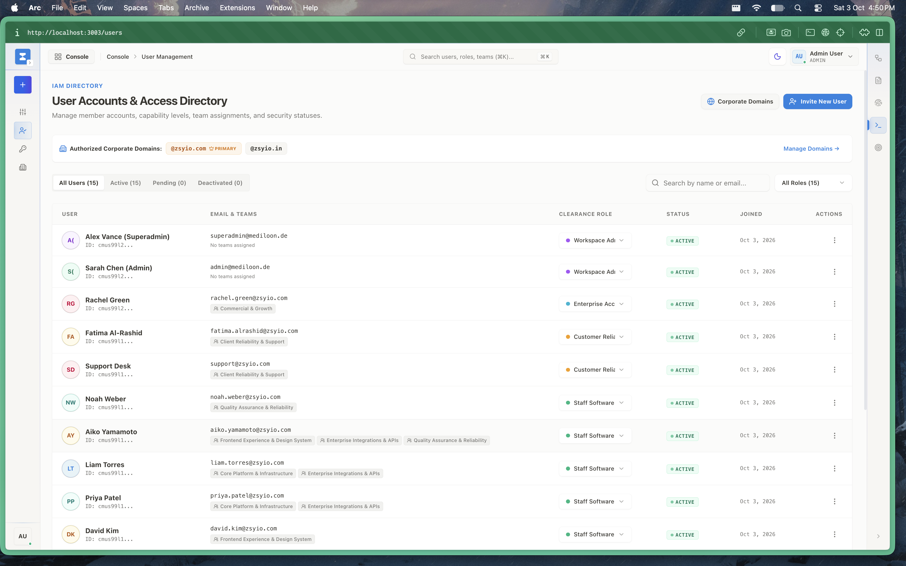
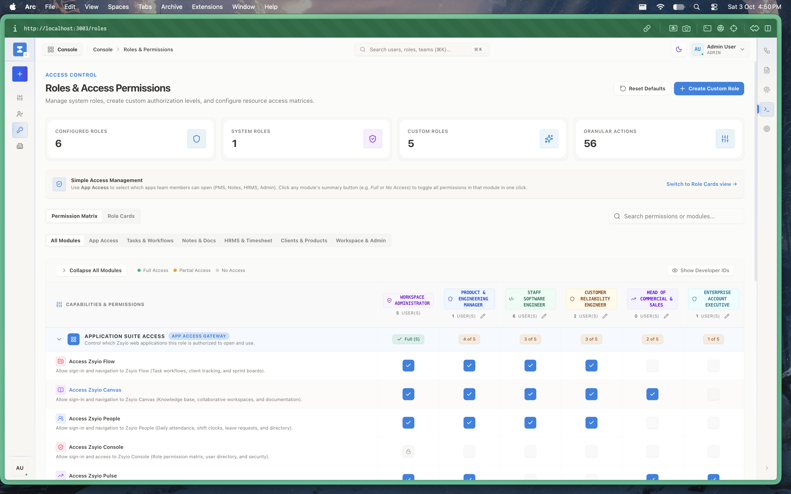
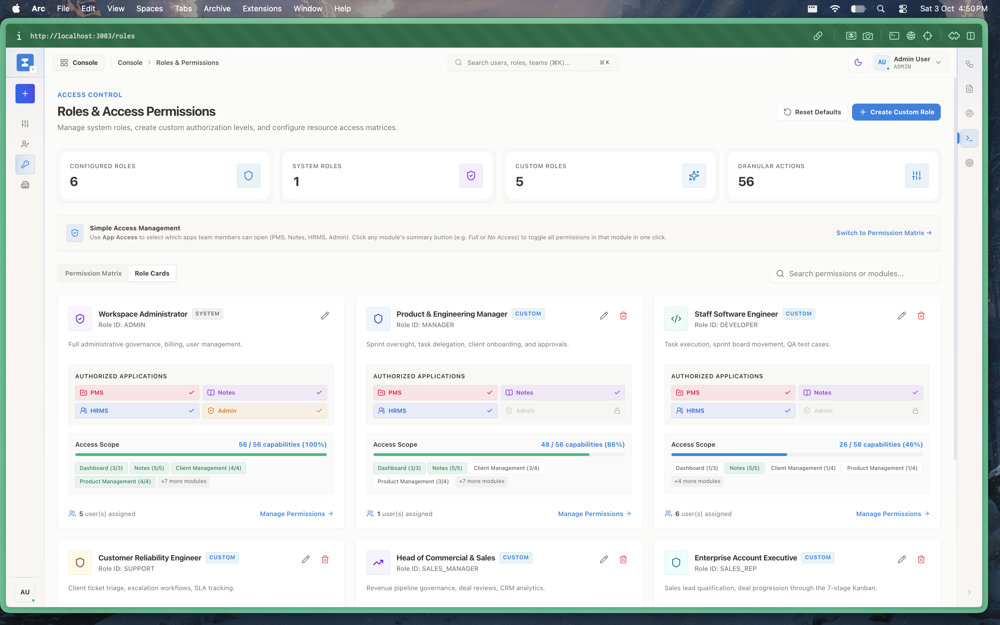
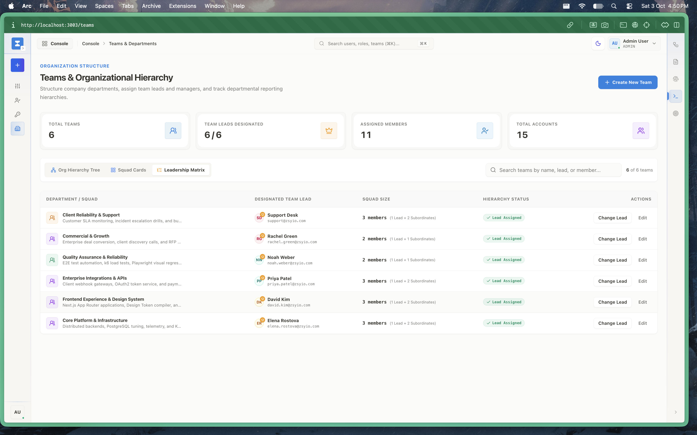
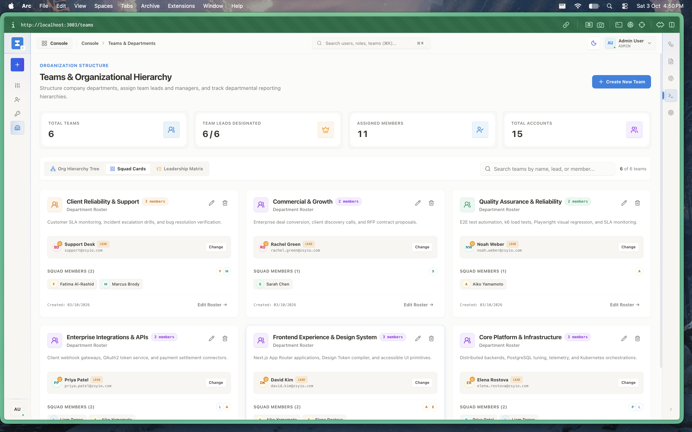
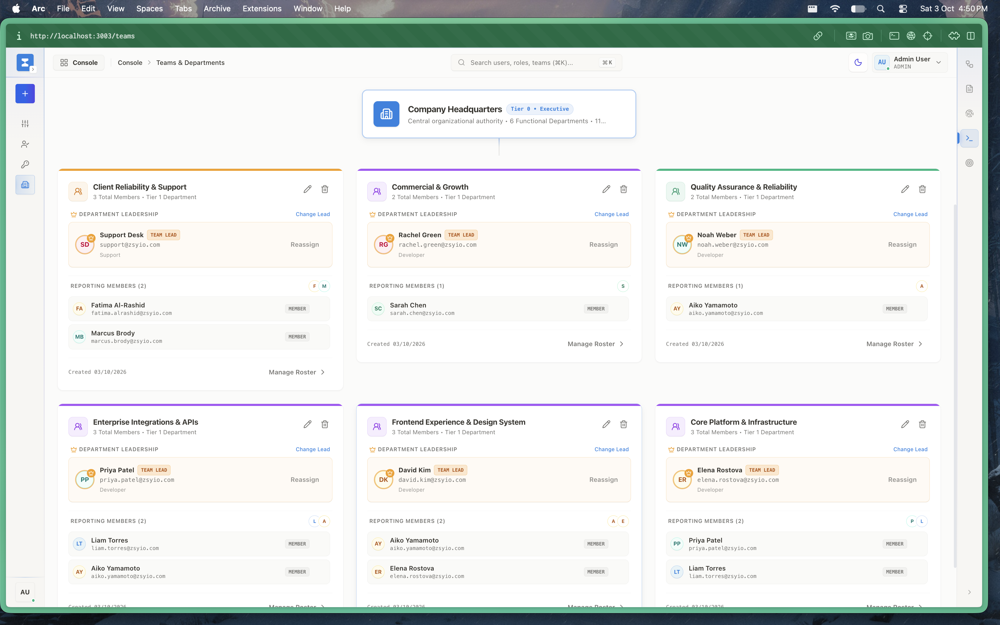

# Zsyio Console — Central Administration, RBAC & Organization Governance

> **The Sovereign Identity, Access Control & Enterprise Governance Plane of the Zsyio Operating System**

---

## 1. What is Zsyio Console?

**Zsyio Console** (also known as *Zsyio Core Admin*) is the centralized administrative control plane that governs the entire Zsyio Suite. It functions as the master identity provider (IAM), security firewall, and organizational authority for all other applications in the monorepo ecosystem. 

Rather than requiring each individual application (PMS, Notes, CRM, HRMS) to manage its own user accounts, roles, access levels, and security policies independently, Zsyio Console provides a single source of truth for:
- Corporate email domain authorization and whitelisting.
- User provisioning, onboarding, invitations, and account deactivation.
- Fine-grained Role-Based Access Control (RBAC) with 56 discrete capability actions.
- Multi-tier organizational hierarchy, departmental reporting structures, and team lead designations.

---

## 2. Why Are We Using It? (The Problem It Solves)

In modern organizations, companies suffer from severe **SaaS fragmentation and security blind spots**:
- **Identity sprawl**: Employees have separate logins for Jira, Notion, Salesforce, BambooHR, and Okta. Revoking access requires manually logging into 5 different portals.
- **Excessive SaaS licensing costs**: Paying monthly per-seat licenses for Okta, Google Workspace Enterprise, and specialized IAM portals.
- **Rogue email signups**: Without strict corporate domain validation, employees or contractors can register using personal Gmail or third-party addresses, causing data leaks.
- **Coarse, unmaintainable permissions**: Traditional tools either give someone full admin rights or read-only access. There is no unified way to grant an engineer edit access to tasks in Flow while restricting them to read-only in Pulse Sales and People HRMS.

### What Zsyio Console Replaces:
- **Okta / Azure AD / Auth0** for internal workspace IAM and corporate domain whitelisting.
- **Google Workspace Admin / Microsoft 365 Admin Center** for internal organization hierarchy and team grouping.
- **Disjointed per-app admin panels** in Jira, Notion, and Salesforce.

---

## 3. Who Is This App For? (Target Personas)

| Persona | Role in Organization | How They Use Zsyio Console |
| :--- | :--- | :--- |
| **Super Administrators** | CTO, VP of Operations, IT Director | Manages global tenant settings, configures authorized email domains, audits activity logs, and resets master policies. |
| **Security & Compliance Officers** | CISO, InfoSec Leads | Audits access matrices, ensures Zero-Trust compliance, manages session security, and enforces corporate domain whitelists. |
| **Department Managers & Leads** | Engineering Leads, Sales Directors | Manages team rosters, designates sub-team leads, and requests custom permissions for contractors. |
| **People Operations** | HR Admin, Office Managers | Coordinates team structures and verifies that newly onboarded employees match official corporate email domains. |

---

## 4. How Zsyio Console Governs & Connects With Other Apps

Zsyio Console acts as the gravitational center for the other four suite applications:

1. **Zsyio Flow (Project Management Suite)**:
   - Task assignment dropdowns and sprint members are pulled directly from Console's verified user directory.
   - Project leads and client delivery permissions are governed by Console's 56-action RBAC matrix.
2. **Zsyio Canvas (Knowledge Base & RFCs)**:
   - Note permissions (View, Comment, Edit, Admin) and private team workspaces are strictly enforced using Console's user security IDs and department tiers.
3. **Zsyio Pulse (Sales CRM)**:
   - Only users with commercial clearances granted by Console can inspect high-value enterprise deal figures, export pipeline data, or modify lead ownership.
4. **Zsyio People (HRMS & Attendance)**:
   - The department leads and managers defined in Console automatically become the authorized leave and timesheet approval authorities in Zsyio People.

---

## 5. Visual Walkthrough & Interface Guide

### 1. Admin & Identity Governance Dashboard
The executive mission control for platform super-administrators and security officers.

- **Zero-Trust Status**: Real-time IAM active badge confirming that all authentication tokens and sessions are validated.
- **Core Governance Metrics**: Active user accounts (15), registered corporate teams (6), and configured permission roles.
- **Top Actions**: Instant triggers to invite new users, configure departments, or audit the RBAC matrix.

---

### 2. Corporate Domain Governance Policy
Automated enforcement rules preventing unauthorized user registrations from personal or rogue email domains.

- **Domain Policy Summary**: Overview of active corporate identity constraints.
- **Protection Scope**: Guarantees that only verified organization domain addresses (e.g. `@zsyio.com`) can claim user seats in the suite.

---

### 3. IAM Directory & Authorized Domain Whitelist
The master user roster combined with authorized email domain management.

- **Authorized Domains**: Displays verified domains such as `@zsyio.com` (Primary) and `@zsyio.in`.
- **User Accounts**: Comprehensive table displaying user avatar, name, email, role badge, assigned team, and active account status.
- **User Actions**: Invite new users, edit role assignments, or revoke access credentials immediately.

---

### 4. Roles & Access Permissions Matrix
Visual permission grid detailing granular capabilities across all suite applications.

- **Capability Scale**: 56 granular actions mapped across system roles (Super Admin, Admin, Member, Guest) and custom roles.
- **Module Coverage**: Fine-grained controls for Tasks, Notes, Clients, Deals, Attendance, and Administration.
- **Reset to Defaults**: One-click rollback safeguard to restore factory security profiles.

---

### 5. Custom Role Builder & Action Configurator
Interface allowing security officers to author tailor-made roles for cross-functional contractors or specialized personnel.

- **Granular Action Switches**: Toggle individual permissions (`Create`, `Read`, `Update`, `Delete`, `Export`, `Administer`).
- **Inheritance & Hierarchy**: Build upon standard templates with surgical permission overrides.

---

### 6. Organization Teams & Department Structure
High-level management of departments, team rosters, and operational capacity.

- **Team Scorecards**: Total teams (6), designated team leads, assigned team members, and linked software products.
- **Creation Flow**: Add new teams with dedicated mission statements, colors, and leadership assignments.

---

### 7. Department Leads & Reporting Hierarchy
Defines line management relationships and approval chains across business units.

- **Leadership Designations**: Explicit mapping of Team Leads and Department Managers.
- **Approval Chains**: Directly powers automated leave and expense routing in **Zsyio People**.

---

### 8. Multi-Tier Department Structure & Roster
Visual breakdown of the enterprise organizational model from executive leadership down to functional units.

- **Tier 0 Executive**: Central company headquarters and executive governance.
- **Tier 1 Functional Departments**:
  - *Engineering & Architecture*: Core platform engineers and technical leads.
  - *Quality Assurance & Reliability*: QA test leads and automation engineers.
  - *Commercial & Growth*: Account executives and sales representatives.
  - *Client Reliability & Support*: Customer success and technical support managers.

---

## 6. Technical Architecture & Implementation

- **Framework**: Next.js 15 (App Router), React 19, TypeScript.
- **State & Data Layer**: Redux Toolkit Query (`usersApi`, `rolesApi`, `teamsApi`, `domainsApi`).
- **Database Models (Prisma)**:
  - `User`: Identity record storing password hashes, corporate email, role ID, and team ID.
  - `Role`: Security entity containing name, description, `isSystem` flag, and permissions JSON array.
  - `Team`: Department entity with name, slug, description, and designated lead ID.
  - `AllowedDomain`: Whitelisted email domain records with primary domain indicators.
- **Domain Restriction Middleware**: Enforced server-side in `packages/auth/src/domain-restriction.ts` and validated via comprehensive unit tests.
- **Security Invariants**:
  - Zero raw hex colors policy strictly enforced via `@zsyio/ui` design tokens.
  - Unauthenticated requests automatically redirected to the corporate login portal.
