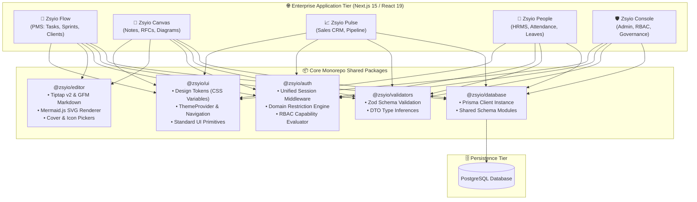

# Zsyio Enterprise Operating System — Suite Master Documentation

> **The Unified Single-Pane-of-Glass Workspace for High-Performance Enterprise Organizations**

Zsyio Suite is an integrated enterprise operational operating system engineered to eliminate corporate SaaS fragmentation. Instead of juggling disconnected silos across Jira, Notion, Salesforce, BambooHR, and Okta, Zsyio consolidates engineering sprint execution, knowledge documentation, sales CRM pipelines, workforce HRMS, and identity governance into a unified, high-density monorepo platform.

---

## Suite Applications Directory

Explore the dedicated visual guides and architectural documentation for each application in the suite:

| Application | Domain & Purpose | Screen Gallery & Docs | Key Features |
| :--- | :--- | :--- | :--- |
| **Zsyio Flow** | Sprint, Task & Client Delivery (PMS) | [📖 Read Flow Documentation](./01-flow-pms/README.md) | Kanban & List task views, stopwatch time tracking, AI task summaries, Git branch generator, client delivery SLA pipelines |
| **Zsyio Canvas** | Knowledge Base, RFCs & Architecture | [📖 Read Canvas Documentation](./02-canvas-notes/README.md) | Tiptap GFM rich editor, live Mermaid SVG architecture diagrams, ADR templates, incident runbooks, custom covers |
| **Zsyio Pulse** | Commercial CRM & Pipeline Hub | [📖 Read Pulse Documentation](./03-pulse-sales/README.md) | Multi-stage deals Kanban, revenue velocity metrics, prospective leads directory, client touchpoint activity logs |
| **Zsyio People** | Workforce HRMS & Attendance | [📖 Read People Documentation](./04-people-hrms/README.md) | Digital punch station, daily/monthly timesheet logs, leave quota ledger, holiday schedule, live presence roster, work rules |
| **Zsyio Console** | Central Identity, RBAC & Governance | [📖 Read Console Documentation](./05-console-admin/README.md) | Zero-Trust IAM, corporate email domain restrictions, 56-action RBAC matrix, custom role creator, multi-tier organizational hierarchy |

---

## System Architecture

The Zsyio Suite is built as a high-performance monorepo utilizing **Turborepo**, **pnpm workspaces**, **Next.js 15 (App Router)**, **React 19**, and **Prisma ORM** over PostgreSQL.



---

## Core Enterprise Capabilities

### 1. Unified Suite Navigation (`SuiteHeader` & `AppSwitcher`)
Users switch seamlessly between the 5 applications via a persistent top-level application switcher in `@zsyio/ui`. Session state, active tenant context, and user authentication remain persistent across all port boundaries.

### 2. Zero-Drift Design System (`@zsyio/ui`)
- **Token Contract**: All styling relies strictly on centralized CSS variables (`tokens.css` and `primitives.json`).
- **Zero Raw Colors**: Raw hex codes are disallowed across application codebases to prevent visual inconsistency.
- **Theme Synchronization**: Persistent, instant switching between Dark Mode and Light Mode with zero layout shift or flickering.

### 3. Integrated Cross-App Data Flows
- **Deal to Delivery**: When a sales deal in **Zsyio Pulse** reaches `Closed Won`, it automatically scaffolds a client account and onboarding sprint in **Zsyio Flow**.
- **Task to RFC**: Engineering tasks in **Zsyio Flow** link directly to architectural specifications and ADRs drafted in **Zsyio Canvas**.
- **Capacity-Aware Sprints**: Sprint assignments in **Zsyio Flow** reference real-time availability and approved time-off from **Zsyio People**.
- **Global Governance**: All identity credentials, role permissions, and corporate email domain restrictions are enforced universally by **Zsyio Console**.

---

## Complete Screenshot & Asset Inventory

All 43 high-resolution interface captures have been renamed to semantic, ordered filenames across their respective application directories:

```text
zsyio/
├── README.md (This Master Document)
├── 01-flow-pms/
│   ├── README.md
│   ├── 01-flow-dashboard.png
│   ├── 02-tasks-board.png
│   ├── 03-tasks-list.png
│   ├── 04-create-task-modal.png
│   ├── 05-task-detail-overview.png
│   ├── 06-task-time-tracking.png
│   ├── 07-task-description-editor.png
│   ├── 08-task-git-branch-helper.png
│   ├── 09-clients-directory.png
│   ├── 10-client-pipeline-kanban.png
│   ├── 11-client-detail-sla.png
│   ├── 12-reports-analytics.png
│   └── 13-profile-settings.png
├── 02-canvas-notes/
│   ├── README.md
│   ├── 01-knowledge-base-folders.png
│   ├── 02-incident-playbook-document.png
│   ├── 03-template-gallery.png
│   ├── 04-cover-picker-customizer.png
│   ├── 05-document-workspace-sidebar.png
│   └── 06-architecture-decision-record.png
├── 03-pulse-sales/
│   ├── README.md
│   ├── 01-sales-dashboard.png
│   ├── 02-deals-pipeline-kanban.png
│   ├── 03-leads-directory.png
│   └── 04-sales-activities-log.png
├── 04-people-hrms/
│   ├── README.md
│   ├── 01-punch-station-dashboard.png
│   ├── 02-work-sessions-overview.png
│   ├── 03-personal-timesheet-daily-log.png
│   ├── 04-monthly-hours-and-overtime.png
│   ├── 05-shift-interval-break-detail.png
│   ├── 06-leave-management-quotas.png
│   ├── 07-apply-leave-and-balances.png
│   ├── 08-annual-holiday-calendar.png
│   ├── 09-team-directory-live-presence.png
│   ├── 10-team-directory-filters.png
│   ├── 11-organization-attendance-sessions.png
│   └── 12-hr-rules-and-leave-allocations.png
└── 05-console-admin/
    ├── README.md
    ├── 01-admin-iam-dashboard.png
    ├── 02-domain-governance-summary.png
    ├── 03-user-directory-domain-whitelist.png
    ├── 04-roles-permissions-matrix.png
    ├── 05-custom-role-builder.png
    ├── 06-teams-and-departments.png
    ├── 07-department-reporting-hierarchy.png
    └── 08-tier-organization-structure.png
```

---

## Development & Monorepo Workflows

```bash
# Install workspace dependencies
pnpm install

# Build shared token contracts and packages
pnpm build

# Run all 5 applications in development mode
pnpm dev

# Execute unit and permission test suites
pnpm test
```
